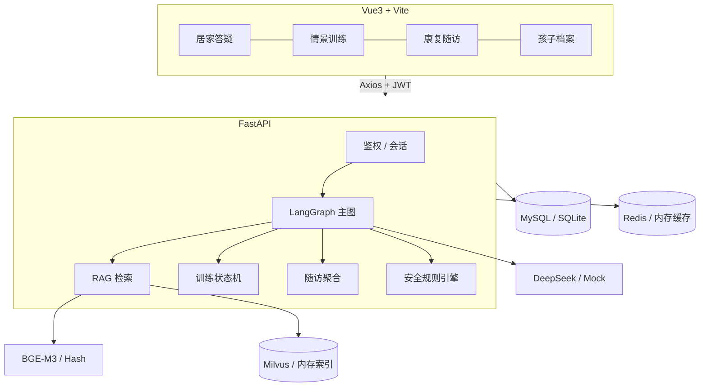
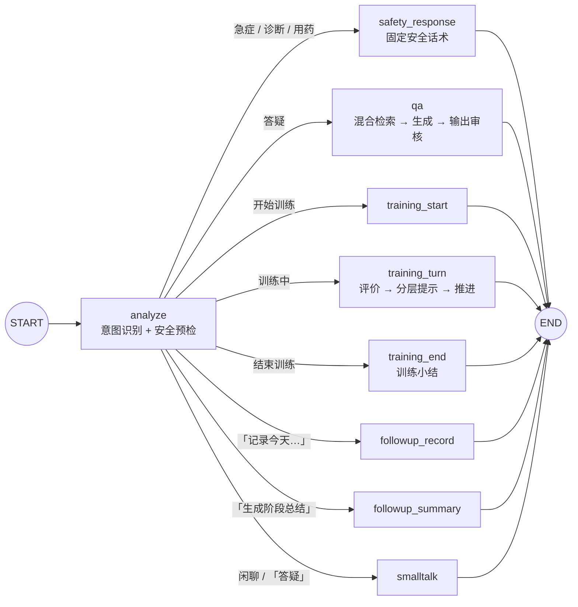

# 破茧之声 · 自闭症儿童居家康复与医疗随访 AI 智能助手

> 一个基于 **LangGraph + RAG + FastAPI** 的垂直领域 Agent 工程实践：
> 把「居家康复答疑」「情景化沟通训练」「家庭随访管理」放进同一条可测试、可降级、带医疗安全边界的业务链路里。
>
> 所有输出仅供居家辅助参考，不构成医疗诊断与治疗方案。


## 目录

- [1. 这个项目解决什么问题](#1-这个项目解决什么问题)
- [2. 技术栈与项目结构](#2-技术栈与项目结构)
- [3. 系统架构](#3-系统架构)
- [4. LangGraph 工作流](#4-langgraph-工作流)
- [5. 三个核心设计](#5-三个核心设计)
- [6. 快速开始](#6-快速开始)
- [7. API 一览](#7-api-一览)
- [8. 数据模型](#8-数据模型)
- [9. 测试与验证](#9-测试与验证)
- [10. 配置说明](#10-配置说明)
- [11. 已知边界与生产化 TODO](#11-已知边界与生产化-todo)
- [12. 面试讲解要点](#12-面试讲解要点)

---

## 1. 这个项目解决什么问题

自闭症谱系儿童的居家康复有三个现实痛点：

1. **知识碎片化**：家长在短视频、群聊、机构话术之间来回切换，很难判断哪条建议可靠；
2. **执行门槛高**：专业训练方案落到家里，往往变成「不知道怎么开口练」；
3. **随访靠回忆**：复诊时说不清这一个月到底发生了什么变化。

「破茧之声」把这三件事做成一条闭环：

| 模块 | 用户动作 | 系统行为 |
| --- | --- | --- |
| 居家康复答疑 | 描述一个具体困扰 | 知识库混合检索 → DeepSeek 生成 → 引用来源 + 输出安全审核 |
| 情景化训练 | 说「开始训练」 | 六类场景状态机：一次一问、分层提示、支持手势/图片回应 |
| 家庭随访 | 每天记一两句话 | 指标由代码聚合，LLM 只负责把指标写成家长看得懂的小结 |
| 医疗安全 | 任何输入 | 规则层拦截急症/诊断/用药/未经验证疗法，独立于 Prompt 生效 |

**它不是「套壳 DeepSeek」**：模型只负责语言表达，路由、检索、训练推进、指标计算、安全边界全部由确定性代码承担。

---

## 2. 技术栈与项目结构

| 层次 | 选型 |
| --- | --- |
| LLM | DeepSeek API（OpenAI 兼容）、JSON 结构化输出 |
| Agent 编排 | LangGraph 1.x 主工作流 + 条件路由 |
| RAG | BGE-M3（可切换）/ 特征哈希降级、Milvus / 内存向量库、混合检索 |
| 后端 | FastAPI、Pydantic v2、SQLAlchemy 2.0 Async ORM |
| 数据 | MySQL 8（默认 SQLite 开发）、Redis 缓存（默认自动降级） |
| 前端 | Vue 3、Vite、Axios、Vue Router |
| 工程 | pytest、Docker Compose、结构化日志、健康检查 |

```text
soud/
├── app/
│   ├── main.py                 # 应用装配、lifespan、健康检查、静态资源托管
│   ├── core/                   # 配置、日志、JWT / scrypt 密码
│   ├── db/                     # 异步引擎、ORM 模型（9 张表）
│   ├── schemas/                # Pydantic 请求/响应模型
│   ├── api/v1/                 # auth / children / chat / training / followup / knowledge / safety
│   ├── agents/
│   │   ├── graph.py            # LangGraph 主图装配
│   │   ├── nodes.py            # 9 个节点（含安全拦截与路由）
│   │   ├── state.py            # 状态定义
│   │   └── prompts.py          # 角色、答疑、随访 Prompt
│   └── services/
│       ├── llm.py              # DeepSeek 客户端 + 离线 Mock
│       ├── embeddings.py       # BGE-M3 / HTTP / 特征哈希
│       ├── vectorstore.py      # Milvus / 内存索引
│       ├── knowledge.py        # 切分、入库、混合检索、引用
│       ├── safety.py           # 医疗安全规则引擎（输入 + 输出两层）
│       ├── training.py         # 情景训练状态机
│       ├── training_scripts.py # 六类场景脚本
│       ├── followup.py         # 每日记录、指标聚合、阶段小结
│       ├── chat.py             # 会话编排：上下文 → 图 → 落库 → 缓存
│       └── container.py        # 服务容器与启动自检
├── knowledge/                  # 11 篇示例知识文档（Markdown + front matter）
├── scripts/                    # 入库、演示数据、端到端冒烟
├── tests/                      # 37 个测试
├── web/                        # Vue3 前端（答疑 / 训练 / 随访 / 档案）
├── docker-compose.yml          # api + mysql + redis（可选 milvus profile）
└── requirements*.txt
```

---

## 3. 系统架构



**关键取舍**：所有外部依赖都有降级路径，`uvicorn app.main:app` 在裸机上就能跑通全链路：

| 组件 | 生产 | 默认 / 降级 |
| --- | --- | --- |
| LLM | DeepSeek | Mock 模板（`meta.mocked=true` 明确标记） |
| Embedding | BGE-M3 / HTTP | 字符 n-gram 特征哈希（确定性、可测试） |
| 向量库 | Milvus | 内存索引 + JSON 持久化 |
| 关系库 | MySQL | SQLite + WAL |
| 缓存 | Redis | 进程内 TTL 缓存 |

---

## 4. LangGraph 工作流

一个主图 + 三条业务分支 + 一条贯穿全流程的安全链路，**没有为了「多智能体」而拆 Agent**：



意图路由是可解释的规则，而不是让 LLM 猜：

- 训练结束 / 开始 / 答疑切换 → 显式指令优先；
- 当前会话存在进行中的训练 → 其余输入都视为训练回合（**训练绑定发起它的聊天会话，不会劫持其他会话**）；
- 「记录」+ 至少两个可解析指标（情绪 1–5、睡眠小时、完成度 %）→ 随访记录；
- 「阶段总结 / 周总结」→ 随访小结；
- 其余 → RAG 答疑。

每个节点只依赖注入进来的服务（`config["configurable"]`），因此可以直接对单个节点做单元测试，也可以把服务替换成桩实现。

---

## 5. 三个核心设计

### 5.1 医疗安全：规则兜底，Prompt 只是第二道防线

只靠 System Prompt 约束医疗边界不可靠，所以做了两层确定性检查：

**输入侧** `assess_input()`

| 等级 | 触发示例 | 行为 |
| --- | --- | --- |
| `emergency` | 抽搐、叫不醒、误吞、走失、自杀表述 | 绕过 LLM，返回 120 / 急诊指引 |
| `redirect` | 「是不是自闭症」「吃什么药」「干细胞/针灸」 | 绕过 LLM，返回统一合规话术 |
| `caution` | 「打自己的头」「咬人」 | 正常答疑，但强制附加安全提醒 |
| `normal` | 普通居家问题 | 走 RAG 答疑 |

**输出侧** `review_output()`

逐句检查模型输出中的越界内容：诊断断言、药物剂量（`10mg`/`2片`）、用药建议、疗效承诺（「保证」「百分之百」「根治」）、未经验证疗法推荐。命中即删除该句；全部被删则回退到安全模板；最后统一追加免责声明。

所有 `redirect` / `emergency` / `caution` 事件写入 `safety_events` 表，便于审计和知识库修订。

### 5.2 RAG：混合检索，宁缺毋滥

```text
问题 → 查询扩展（领域同义词）→ 向量召回 Top-N
     → IDF 加权字符 n-gram 覆盖率（词法）
     → 加权融合 → 阈值过滤 → Top-K + 引用编号
```

几个刻意的选择：

- **保留词法分数**：康复语料里「感觉统合」「辅助沟通」「听觉敏感」等专有名词，纯向量在低资源模型下容易漏召回；
- **阈值之下不兜底**：很多 RAG Demo 会在没命中时返回「最相似的一条」，医疗场景下这比直说「没检索到」更危险；
- **引用可追溯**：每条引用带标题、章节、来源、片段摘要，家长可以自行核查；
- **切分尊重文档结构**：先按 `##` 分节，再在节内按句子边界滑窗（320 字 / 60 重叠），避免把一句话切断。

知识入库支持增量 `upsert`，`knowledge_docs` 表记录文档 checksum 与块数，重复入库不会产生重复块。

### 5.3 情景训练：状态机而不是「让模型自由发挥」

六类场景（道谢 / 求助 / 表达不适 / 拒绝 / 邀约 / 购物），共 19 个回合，每个回合包含：

- 情境描述（一次只问一个问题）；
- 可接受表达的关键词集合；
- **三级提示**：线索 → 开头 → 完整示范；
- 具体化表扬（说出孩子做到了什么，而不是「真棒」）。

推进规则：

```text
孩子回应 ──┬─ 命中目标 / 使用手势图片 ──→ 表扬 + 进入下一回合
           ├─ 答偏（第 1 次）──────────→ 线索提示，停留原回合
           ├─ 答偏（第 2 次）──────────→ 开头提示，停留原回合
           └─ 答偏（第 3 次 / 说「不会」）→ 示范后推进，不纠缠
```

设计底线：不强迫眼神接触、不强迫开口；手势、图片、文字、点头都算完成；孩子说「不想」时立即停止。

### 5.4 随访：指标由代码算，LLM 只写叙述

`avg_mood`、`avg_sleep_hours`、`avg_completion`、`mood_trend`、训练项目频次全部由 `FollowupService.aggregate()` 用纯函数计算，可复核、可单测；LLM 只把指标与每日记录改写成「总体情况 / 值得注意的变化 / 下周可尝试 / 建议就医的情形」四段式小结，落库保存。

---

## 6. 快速开始

### 6.1 本地运行（零外部依赖）

```bash
python -m venv .venv && .venv\Scripts\activate     # Windows
# source .venv/bin/activate                        # macOS / Linux
pip install -r requirements-dev.txt

cp .env.example .env        # 默认 mock LLM + hash 向量 + SQLite + 内存向量库
python -m scripts.seed_demo # 演示账号 demo / demo123456、孩子档案、7 天记录

python -m uvicorn app.main:app --reload --port 8000
```

另开一个终端启动前端：

```bash
cd web
pnpm install
pnpm dev     # http://localhost:5173（已配置 /api 代理到 8000）
```

打开 <http://localhost:5173>，用 `demo / demo123456` 登录。
也可以只跑后端：`cd web && pnpm build` 后，`web/dist` 会被 FastAPI 自动托管在 <http://localhost:8000>。

### 6.2 接入真实模型

```bash
# .env
LLM_PROVIDER=deepseek
DEEPSEEK_API_KEY=sk-xxxx

# 有 GPU / 本地模型时
pip install -r requirements-rag.txt
EMBEDDING_PROVIDER=bge-m3
VECTOR_BACKEND=milvus
MILVUS_URI=http://127.0.0.1:19530
```

重新入库：`python -m scripts.ingest_kb`。

### 6.3 Docker Compose

```bash
cp .env.example .env
docker compose up -d --build          # api + mysql + redis
docker compose --profile vector up -d # 可选：etcd + minio + milvus
```

访问 <http://localhost:8000>（前端已打进镜像）。

---

## 7. API 一览

统一前缀 `/api/v1`，除注册/登录外都需要 `Authorization: Bearer <token>`。

| 方法 | 路径 | 说明 |
| --- | --- | --- |
| POST | `/auth/register` | 注册（返回 JWT） |
| POST | `/auth/login` | 登录 |
| GET | `/auth/me` | 当前用户 |
| GET/POST | `/children` | 孩子档案列表 / 创建 |
| POST | `/chat` | **核心入口**：答疑、训练、随访记录、阶段总结 |
| GET | `/chat/sessions` | 会话列表 |
| GET | `/chat/sessions/{id}` | 会话详情（含消息与引用） |
| DELETE | `/chat/sessions/{id}` | 删除会话 |
| GET | `/training/scenarios` | 六类场景目录 |
| POST | `/training/start` | 独立训练页开始训练 |
| POST | `/training/{id}/answer` | 提交孩子回应，返回反馈与下一问 |
| POST | `/training/{id}/end` | 结束并生成训练小结 |
| GET | `/training/sessions` | 训练历史 |
| POST | `/followup/records` | 创建每日记录 |
| GET | `/followup/records?child_id=` | 记录列表 |
| POST | `/followup/summary` | 生成阶段小结（含指标） |
| GET | `/followup/summaries?child_id=` | 历史小结 |
| GET | `/knowledge/docs` | 知识文档与块数 |
| POST | `/knowledge/search` | 检索调试（返回向量/词法/融合分数） |
| POST | `/knowledge/ingest` | 重新入库（professional / admin） |
| GET | `/safety/events` | 安全事件审计（admin） |
| GET | `/health` | 健康检查（组件与知识块数量） |

`POST /chat` 响应示例（截断）：

```json
{
  "session_id": "1d4f...",
  "reply": "关于「孩子晚上不肯睡觉…」，知识库里有这些可以参考的内容：…",
  "intent": "qa",
  "mode": "qa",
  "safety": {"level": "normal", "categories": []},
  "citations": [
    {"index": 1, "title": "睡眠与作息：把睡前变成可预测的流程", "section": "固定流程比固定时间更关键", "score": 0.41}
  ],
  "meta": {"llm_provider": "mock", "mocked": true, "retrieved": 3}
}
```

---

## 8. 数据模型

| 表 | 作用 |
| --- | --- |
| `users` | 账号、角色（parent / professional / admin） |
| `children` | 孩子档案（家长自述，不含诊断结论） |
| `chat_sessions` / `chat_messages` | 会话与消息（含 intent、安全等级、引用 JSON） |
| `training_sessions` | 训练状态：场景、步骤、提示层级、transcript、小结 |
| `followup_records` | 每日情绪 / 睡眠 / 行为 / 训练完成度 |
| `followup_summaries` | 阶段小结正文与聚合指标 |
| `safety_events` | 安全拦截审计 |
| `knowledge_docs` | 知识文档 checksum 与块数 |

生产环境建议用 Alembic 管理迁移（当前为 `create_all`，便于演示）。

---

## 9. 测试与验证

```bash
python -m pytest -q            # 37 passed
python -m scripts.smoke_e2e    # 对运行中的服务跑完整链路
```

测试覆盖：

- `test_security.py`：scrypt 哈希、JWT 签发/篡改/过期；
- `test_safety.py`：急症、诊断、用药、未验证疗法、输出越界清洗、免责声明幂等；
- `test_rag.py`：文档解析、切分、入库、混合检索、阈值、引用编号去重；
- `test_training.py`：推进、三级提示、提示耗尽后跳过、AAC 回应、幂等结束、越权 404；
- `test_chat_api.py`：答疑引用、急症拦截、聊天内模式切换、会话增删、401；
- `test_followup.py`：记录校验、指标均值、阶段小结、跨用户隔离。

冒烟脚本会依次验证：登录 → 健康检查 → RAG 答疑（带引用）→ 安全拦截 → 聊天内训练 → 训练小结 → 随访记录与阶段小结 → 知识检索。

---

## 10. 配置说明

常用环境变量（完整见 `.env.example`）：

| 变量 | 默认 | 说明 |
| --- | --- | --- |
| `LLM_PROVIDER` | `mock` | `mock` / `deepseek` |
| `DEEPSEEK_API_KEY` | 空 | 为空时自动降级 Mock |
| `EMBEDDING_PROVIDER` | `hash` | `hash` / `bge-m3` / `http` |
| `VECTOR_BACKEND` | `memory` | `memory` / `milvus` |
| `DATABASE_URL` | SQLite | `mysql+aiomysql://...` |
| `CACHE_ENABLED` | `true` | Redis 不可用时自动使用进程内缓存 |
| `RAG_TOP_K` / `RAG_MIN_SCORE` | 4 / 0.3 | 召回条数与融合分数阈值 |
| `RAG_CHUNK_SIZE` / `OVERLAP` | 320 / 60 | 切块参数 |
| `HISTORY_WINDOW` | 10 | 送入模型的历史消息条数 |
| `TRAINING_MAX_HINT_LEVEL` | 2 | 分层提示层数（第 3 次给示范） |

---

## 11. 已知边界与生产化 TODO

**明确的边界**

- `knowledge/` 是**示例知识库**，内容依据公开家长手册与临床实践共识整理，上线前必须由儿童保健科 / 发育行为科专业人员逐条审核；
- 系统不做诊断、不做康复评定、不给用药建议，不能替代医生与持证康复师；
- 默认的 hash 向量只保证链路可跑通，不具备语义泛化能力，生产请切 BGE-M3 或远程嵌入；
- Mock 模式只是模板生成，响应里会标记 `mocked: true`，不要用于真实业务。

**下一步可以做的**

1. Alembic 迁移 + 生产级连接池参数；
2. RAG 评估集（100 条家长真实问题 + 标准片段），持续跟踪 Recall@K 与无答案拒答率；
3. 知识库审核工作流（草稿 / 审核 / 发布三态 + 审核人字段）；
4. 安全分类器与规则并行（LLM 判别隐晦的自伤风险表述）；
5. 训练过程接入语音（ASR）与图片选择，降低家长录入负担；
6. 可观测性：OpenTelemetry + 每次生成的 trace（检索片段、Prompt 版本、token 消耗）；
7. 前端：会话搜索、随访趋势图、无障碍与移动端适配。

---

## 12. 面试讲解要点

如果把这个项目写进简历，可以这样表述（每条都能在代码里找到对应实现）：

- **Agent 编排**：基于 LangGraph 实现「意图路由 → 安全审核 → 答疑 / 训练 / 随访」主工作流，训练状态机支持三级分层提示与替代沟通（AAC）回应，37 个 pytest 用例覆盖路由、状态推进与越权访问；
- **RAG 工程**：BGE-M3 + Milvus 生产链路与 hash + 内存索引的离线降级链路共用一套接口，混合检索（向量 + IDF 加权词法）并设置拒答阈值，引用可回溯到文档章节；
- **医疗安全**：规则引擎在输入侧拦截急症 / 诊断 / 用药 / 未验证疗法，在输出侧逐句清洗剂量与疗效承诺，安全事件落库审计，不依赖 Prompt「祈祷模型听话」；
- **工程化**：FastAPI + SQLAlchemy Async + Redis + MySQL，Docker Compose 一键启动，健康检查暴露各组件降级状态。

**可以主动讲的三个「坑」**（比堆功能更能体现工程判断）：

1. **依赖注入的提交时机**：FastAPI `yield` 依赖在响应之后才提交，客户端拿到 `session_id` 立刻发下一轮请求时可能读不到数据。改为在服务层显式 `commit` 后，竞态消失；
2. **RAG 的「兜底返回最佳一条」是陷阱**：早期为了让 Demo 总有引用，阈值不命中时返回最相似片段，结果把不相关知识当成依据。医疗场景改为「宁缺毋滥」，并加评估集；
3. **多会话状态串扰**：训练最初只按 `user_id` 查进行中的会话，导致 A 会话的训练劫持了 B 会话的答疑。改为按 `chat_session_id` 绑定，并增加「答疑」退出指令。

---

<p align="center">
  <sub>破茧之声 · 居家康复辅助工具 · 不构成医疗诊断与治疗方案</sub>
</p>
