# 破茧之声 · 自闭症儿童居家康复与医疗随访 AI 智能助手

> 一个基于 **LangGraph + RAG + FastAPI** 的垂直领域 Agent 工程实践：
> 把「居家康复答疑」「情景化沟通训练」「家庭随访管理」放进同一条可测试、可降级、带医疗安全边界的业务链路里。
>
> 所有输出仅供居家辅助参考，不构成医疗诊断与治疗方案。

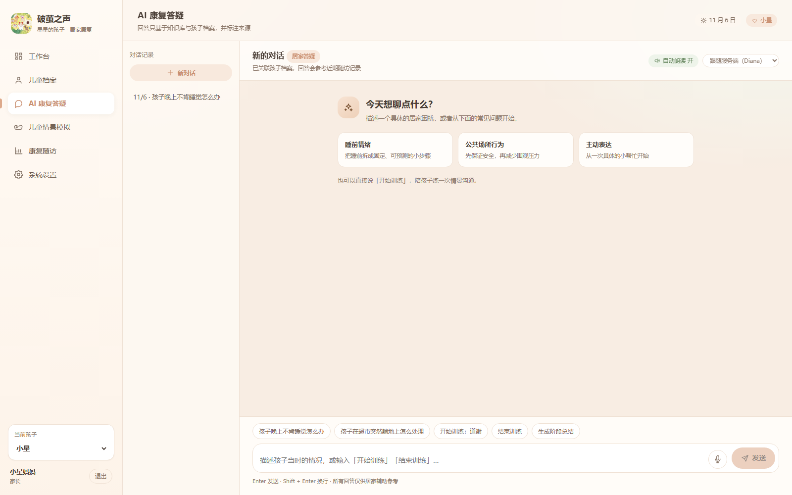

## 目录

- [1. 这个项目解决什么问题](#1-这个项目解决什么问题)
- [2. 技术栈与项目结构](#2-技术栈与项目结构)
- [3. 系统架构](#3-系统架构)
- [4. LangGraph 工作流](#4-langgraph-工作流)
- [5. 三个核心设计](#5-三个核心设计)
- [6. 快速开始](#6-快速开始)
- [7. API 一览](#7-api-一览)
- [8. 数据模型](#8-数据模型)
- [9. 测试与验证](#9-测试与验证)
- [10. 配置说明](#10-配置说明)
- [11. 已知边界与生产化 TODO](#11-已知边界与生产化-todo)

---

## 1. 这个项目解决什么问题

自闭症谱系儿童的居家康复有三个现实痛点：

1. **知识碎片化**：家长在短视频、群聊、机构话术之间来回切换，很难判断哪条建议可靠；
2. **执行门槛高**：专业训练方案落到家里，往往变成「不知道怎么开口练」；
3. **随访靠回忆**：复诊时说不清这一个月到底发生了什么变化。

「破茧之声」把这三件事做成一条闭环：

| 模块 | 用户动作 | 系统行为 |
| --- | --- | --- |
| 居家康复答疑 | 描述一个具体困扰 | 知识库混合检索 → DeepSeek 生成 → 引用来源 + 输出安全审核 |
| 情景化训练 | 说「开始训练」 | 六类场景状态机：一次一问、分层提示、支持手势/图片回应 |
| **2D 情景游戏** | 点地面走路、点家具/角色互动 | 同一套六场景状态机 + 等距房间：走到角色身边说话，判定仍由后端负责 |
| 家庭随访 | 每天记一两句话 | 指标由代码聚合，LLM 只负责把指标写成家长看得懂的小结 |
| 语音随访 | 按住麦克风说一段 | ASR 转写（可编辑）→ AI 结构化草稿 → 家长确认后落库 |
| 回答朗读 | 点喇叭或开启自动朗读 | CosyVoice2 云端音色，失败回退浏览器系统语音 |
| 医疗安全 | 任何输入 | 规则层拦截急症/诊断/用药/未经验证疗法，独立于 Prompt 生效 |

**它不是「套壳 DeepSeek」**：模型只负责语言表达，路由、检索、训练推进、指标计算、安全边界全部由确定性代码承担。

---

## 2. 技术栈与项目结构

| 层次 | 选型 |
| --- | --- |
| LLM | DeepSeek API（OpenAI 兼容）、JSON 结构化输出 |
| Agent 编排 | LangGraph 1.x 主工作流 + 条件路由 |
| RAG | BGE-M3（可切换）/ 特征哈希降级、Milvus / 内存向量库、混合检索 |
| 后端 | FastAPI、Pydantic v2、SQLAlchemy 2.0 Async ORM |
| 数据 | MySQL 8（默认 SQLite 开发）、Redis 缓存（默认自动降级） |
| 前端 | Vue 3、Vite、Axios、Vue Router |
| 工程 | pytest、Docker Compose、结构化日志、健康检查 |

```text
soud/
├── app/
│   ├── main.py                 # 应用装配、lifespan、健康检查、静态资源托管
│   ├── core/                   # 配置、日志、JWT / scrypt 密码
│   ├── db/                     # 异步引擎、ORM 模型（9 张表）
│   ├── schemas/                # Pydantic 请求/响应模型
│   ├── api/v1/                 # auth / children / chat / training / game / followup / knowledge / safety
│   ├── agents/
│   │   ├── graph.py            # LangGraph 主图装配
│   │   ├── nodes.py            # 9 个节点（含安全拦截与路由、游戏回合入口）
│   │   ├── state.py            # 状态定义
│   │   └── prompts.py          # 角色、答疑、随访 Prompt
│   └── services/
│       ├── llm.py              # DeepSeek 客户端 + 离线 Mock
│       ├── embeddings.py       # BGE-M3 / HTTP / 特征哈希
│       ├── vectorstore.py      # Milvus / 内存索引
│       ├── knowledge.py        # 切分、入库、混合检索、引用
│       ├── safety.py           # 医疗安全规则引擎（输入 + 输出两层）
│       ├── training.py         # 情景训练状态机
│       ├── training_scripts.py # 六类场景脚本
│       ├── game_worlds.py      # 2D 世界配置：房间 / 角色 / 热点 / 任务绑定
│       ├── training_world.py   # 游戏存档（房间、坐标、已观察热点）
│       ├── training_judge.py   # DeepSeek 语义复判（可选，只增不减）
│       ├── followup.py         # 每日记录、指标聚合、阶段小结、语音草稿
│       ├── audio.py            # 音频头/大小/时长校验（ffmpeg）
│       ├── asr/                # ASR Provider：FunASR / HTTP / disabled
│       ├── chat.py             # 会话编排：上下文 → 图 → 落库 → 缓存
│       └── container.py        # 服务容器与启动自检
├── knowledge/                  # 11 篇示例知识文档（Markdown + front matter）
├── scripts/                    # 入库、演示数据、端到端冒烟
├── tests/                      # 65 个测试
├── web/                        # Vue3 前端（工作台 / 档案 / 答疑 / 2D 游戏 / 随访 / 设置）
│   ├── src/styles.css          # 星星的孩子设计系统：主题变量 + 统一组件样式
│   ├── src/components/         # AppIcon / StateBlock / TrendChart / VoiceRecorder / SafetyBanner
│   └── src/game/               # 统一游戏引擎：等距投影、A* 寻路、房间与角色手绘 SVG
├── docker-compose.yml          # api + mysql + redis（可选 milvus profile）
└── requirements*.txt
```

### 2.1 前端视觉系统：星星的孩子

后台与儿童游戏是两套界面语言，但共用同一套品牌色：

| 变量 | 值 | 用途 |
| --- | --- | --- |
| `--color-page` | `#F8EDE3` | 奶油白/浅杏底 |
| `--color-surface` | `#FFFFFF` | 卡片与输入框 |
| `--color-primary` | `#DDAA8C` | 暖陶主按钮 |
| `--color-primary-hover` | `#C98F70` | 悬停/强调 |
| `--color-secondary` | `#B9C9B1` | 鼠尾草辅助按钮 |
| `--color-accent` | `#F1D98F` | 暖阳提示 |
| `--color-pink` | `#E7C5C0` | 柔和点缀 |
| `--color-text` | `#493D35` | 正文 |
| `--color-text-secondary` | `#8C786A` | 次要信息 |
| `--color-border` | `#EFE1D4` | 分隔与描边 |

- **管理后台**：左侧导航 + 顶部工具栏 + 卡片式内容，圆角 14–26px、柔和阴影；工作台 / 儿童档案 / AI 答疑 / 康复随访 / 系统设置五页。
- **儿童游戏**：独立沉浸式路由（`/game`），不显示后台侧边栏；游戏内部沿用 2D 等距卡通与马卡龙配色，只有入口页与品牌色衔接。
- **组件规范**：`.btn`（primary / secondary / ghost / soft / danger / small / block）、`.input`、`.card`、`.badge`、`.modal`、`.state-block`（loading / empty / error）、`.switch`、`.chart-*` 全部来自同一份 `styles.css`，页面不硬编码颜色。
- **动效与无障碍**：页面淡入、卡片浮起、气泡出现、进度条过渡；支持系统的 `prefers-reduced-motion`，设置页还可手动关闭动效。

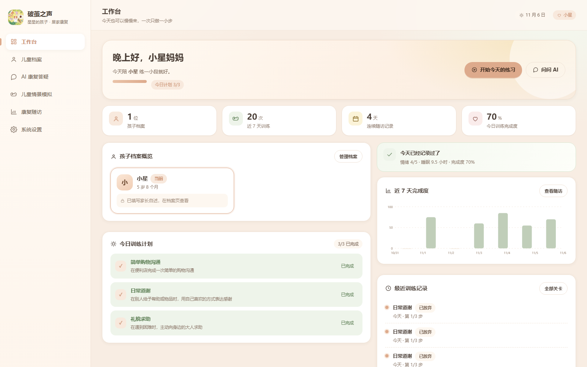

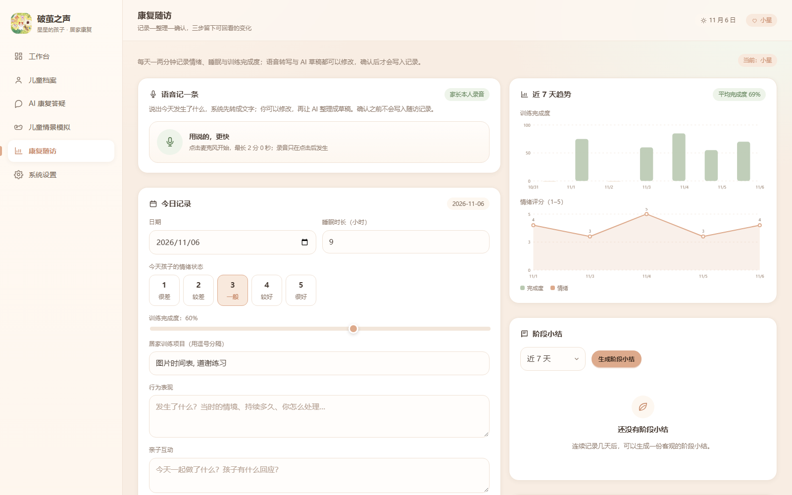
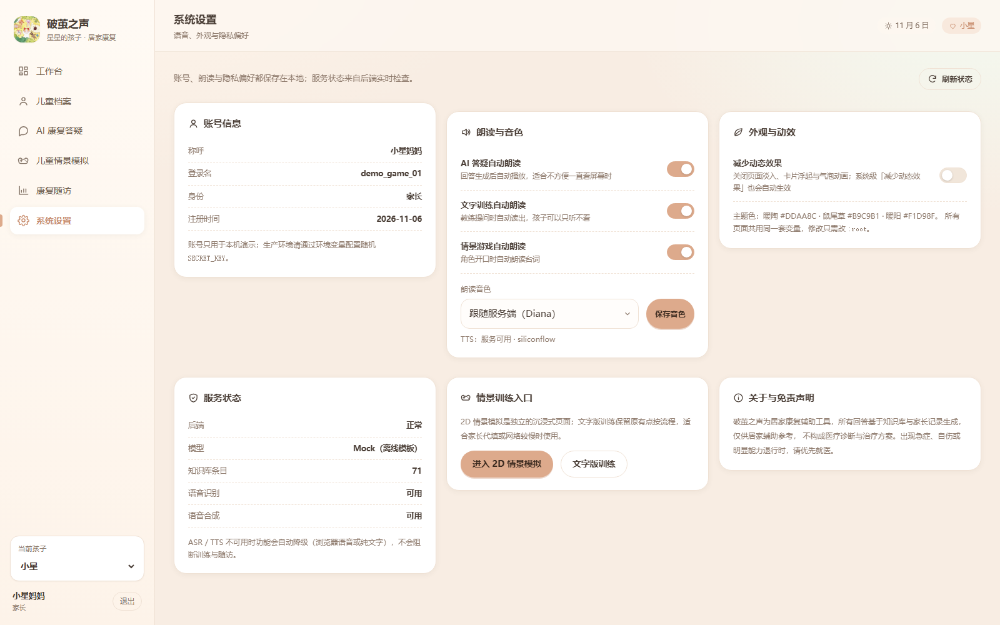

移动端（≤720px）侧边栏收成图标条，卡片单列排布：

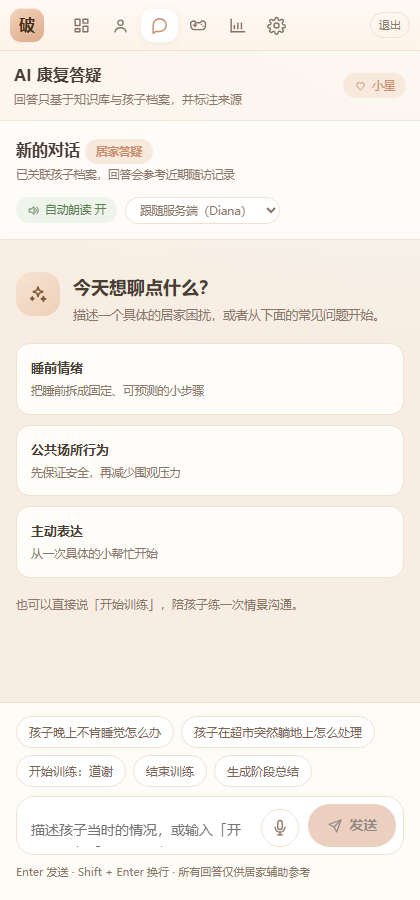

---

## 3. 系统架构

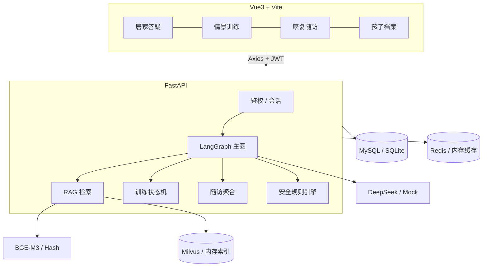

**关键取舍**：所有外部依赖都有降级路径，`uvicorn app.main:app` 在裸机上就能跑通全链路：

| 组件 | 生产 | 默认 / 降级 |
| --- | --- | --- |
| LLM | DeepSeek | Mock 模板（`meta.mocked=true` 明确标记） |
| Embedding | BGE-M3 / HTTP | 字符 n-gram 特征哈希（确定性、可测试） |
| 向量库 | Milvus | 内存索引 + JSON 持久化 |
| 关系库 | MySQL | SQLite + WAL |
| 缓存 | Redis | 进程内 TTL 缓存 |

---

## 4. LangGraph 工作流

一个主图（安全审核 + 意图路由）+ 一个**自反思答疑子图** + 训练/随访/闲聊分支，**没有为了「多智能体」而拆 Agent**：

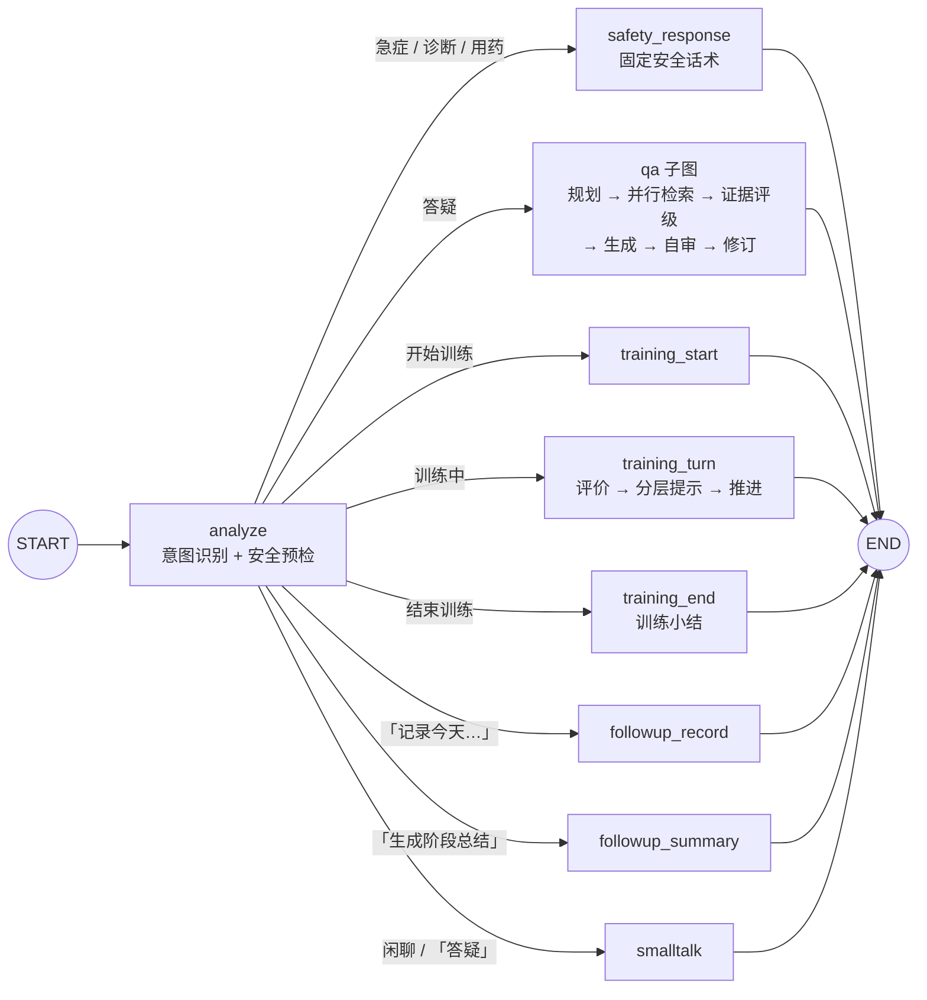

答疑子图是本项目最「像 Agent」的部分——**它会因为证据不足而重新检索，也会因为自审不过而重写答案**：

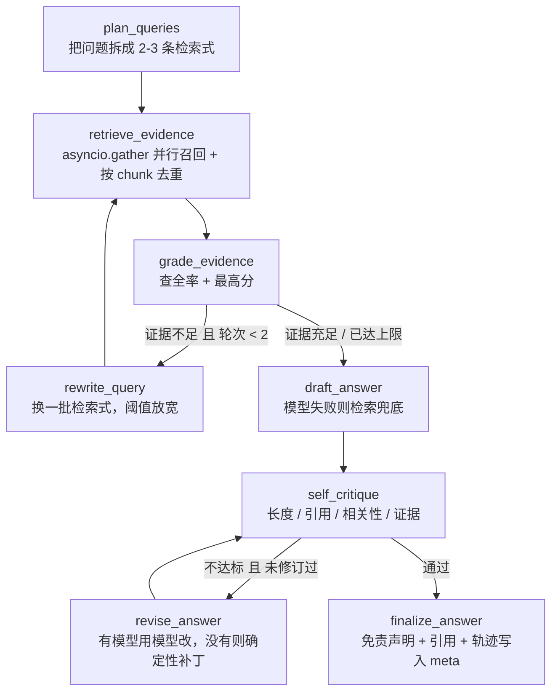

几条关键设计：

- **规划可降级**：有真实模型时用 JSON 模式让模型拆检索式；`mock` 或模型失败时退化为规则拆句（同义扩展 + 分句），不会因为没 Key 就断链；
- **真并行**：多条检索式同时召回，按 `chunk.id` 去重取最高分，而不是串行跑多次；
- **两条回边都有上限**（检索 2 轮、修订 1 轮），图一定收敛，不会出现"自我反思到死循环"；
- **自审是确定性规则**（回答长度、是否带 `[n]` 引用、与提问的词法重合度、是否有检索证据），不依赖模型自我评价，结果可复现；
- **执行轨迹可展示**：每个节点把摘要写进 `state.trace`，最终随响应返回 `meta.agent_trace`，前端或 PPT 可以直接画出来。

意图路由是可解释的规则，而不是让 LLM 猜：

- 训练结束 / 开始 / 答疑切换 → 显式指令优先；
- 当前会话存在进行中的训练 → 其余输入都视为训练回合（**训练绑定发起它的聊天会话，不会劫持其他会话**）；
- 「记录」+ 至少两个可解析指标（情绪 1–5、睡眠小时、完成度 %）→ 随访记录；
- 「阶段总结 / 周总结」→ 随访小结；
- 其余 → 进入上面的答疑子图。

每个节点只依赖注入进来的服务（`config["configurable"]`），因此可以直接对单个节点做单元测试，也可以把服务替换成桩实现。

---

## 5. 三个核心设计

### 5.1 医疗安全：规则兜底，Prompt 只是第二道防线

只靠 System Prompt 约束医疗边界不可靠，所以做了两层确定性检查：

**输入侧** `assess_input()`

| 等级 | 触发示例 | 行为 |
| --- | --- | --- |
| `emergency` | 抽搐、叫不醒、误吞、走失、自杀表述 | 绕过 LLM，返回 120 / 急诊指引 |
| `redirect` | 「是不是自闭症」「吃什么药」「干细胞/针灸」 | 绕过 LLM，返回统一合规话术 |
| `caution` | 「打自己的头」「咬人」 | 正常答疑，但强制附加安全提醒 |
| `normal` | 普通居家问题 | 走 RAG 答疑 |

**输出侧** `review_output()`

逐句检查模型输出中的越界内容：诊断断言、药物剂量（`10mg`/`2片`）、用药建议、疗效承诺（「保证」「百分之百」「根治」）、未经验证疗法推荐。命中即删除该句；全部被删则回退到安全模板；最后统一追加免责声明。

所有 `redirect` / `emergency` / `caution` 事件写入 `safety_events` 表，便于审计和知识库修订。

### 5.2 RAG：混合检索，宁缺毋滥

```text
问题 → 查询扩展（领域同义词）→ 向量召回 Top-N
     → IDF 加权字符 n-gram 覆盖率（词法）
     → 加权融合 → 阈值过滤 → Top-K + 引用编号
```

几个刻意的选择：

- **保留词法分数**：康复语料里「感觉统合」「辅助沟通」「听觉敏感」等专有名词，纯向量在低资源模型下容易漏召回；
- **阈值之下不兜底**：很多 RAG Demo 会在没命中时返回「最相似的一条」，医疗场景下这比直说「没检索到」更危险；
- **引用可追溯**：每条引用带标题、章节、来源、片段摘要，家长可以自行核查；
- **切分尊重文档结构**：先按 `##` 分节，再在节内按句子边界滑窗（320 字 / 60 重叠），避免把一句话切断。

知识入库支持增量 `upsert`，`knowledge_docs` 表记录文档 checksum 与块数，重复入库不会产生重复块。

### 5.3 情景训练：状态机而不是「让模型自由发挥」

六类场景（道谢 / 求助 / 表达不适 / 拒绝 / 邀约 / 购物），共 19 个回合，每个回合包含：

- 情境描述（一次只问一个问题）；
- 可接受表达的关键词集合；
- **三级提示**：线索 → 开头 → 完整示范；
- 具体化表扬（说出孩子做到了什么，而不是「真棒」）。

推进规则：

```text
孩子回应 ──┬─ 命中目标 / 使用手势图片 ──→ 表扬 + 进入下一回合
           ├─ 答偏（第 1 次）──────────→ 线索提示，停留原回合
           ├─ 答偏（第 2 次）──────────→ 开头提示，停留原回合
           └─ 答偏（第 3 次 / 说「不会」）→ 示范后推进，不纠缠
```

设计底线：不强迫眼神接触、不强迫开口；手势、图片、文字、点头都算完成；孩子说「不想」时立即停止。

### 5.4 2D 情景游戏：把同一套训练演成可以走进去的房间

六个训练场景原样保留（`thanks / help / discomfort / refuse / invite / shopping`），
但在文字流程之外多了一层「空间演出层」：四个可复用的等距房间（客厅 / 教室 / 操场 / 便利店）、
固定的小朋友与老师/家长角色、可点击的家具热点。**训练语料仍然只有一份**，
游戏页展示的 prompt、提示、表扬全部来自后端，前端不复制任何一句训练文案。

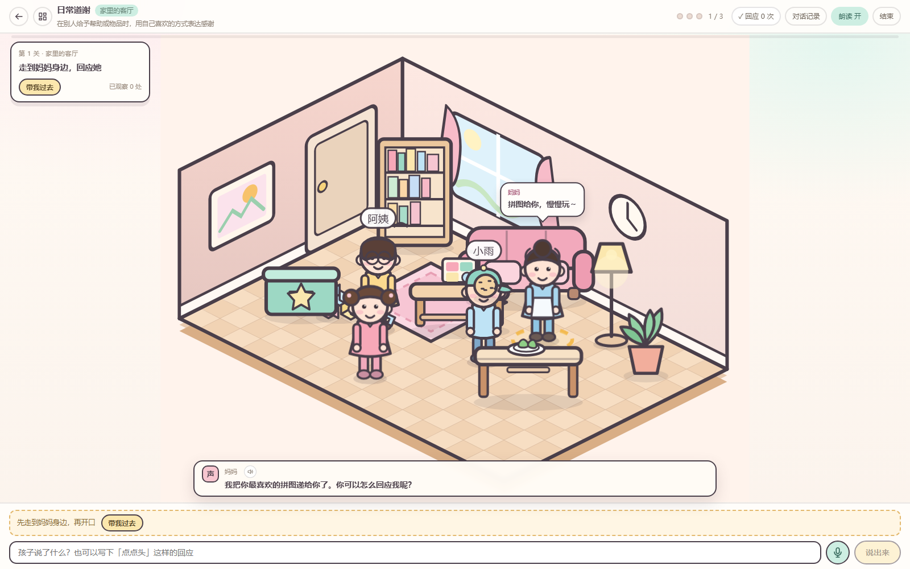

一个回合的真实链路：

```text
点击地面 → iso 反投影 → 网格 A* → rAF 逐帧移动 → 走到角色斜前方
点击角色/家具 → 角色走过去 → 对话气泡 / 观察说明（探索度 +1）
靠近后作答（文字 / 语音 / 非语言按钮）
   → POST /api/v1/game/{id}/turn
     → LangGraph analyze（先过医疗安全规则）
     → training_turn
       → TrainingService.respond（关键词 + AAC 线索 → 分层提示 → 推进）
         ↳ DeepSeek 语义复判（仅在规则未通过且 provider=deepseek 时启用，只增不减）
   → 气泡里的表扬 / 教练卡里的提示 → 任务勾选 → 自动存档
```

复用关系（不新建训练内核）：

| 原有能力 | 在游戏里的用法 |
| --- | --- |
| LangGraph 主图 | 游戏回合走同一张图：安全审核 → `training_turn` → 状态机 |
| DeepSeek | 可选语义复判：孩子换一种说法也能被听懂；模型不可用时静默回退规则 |
| 训练状态机 | 第几步、提示层级、正确次数、小结全部由它决定 |
| ASR / TTS | 麦克风走 `/audio/transcribe`，朗读走 `/audio/speech` + 浏览器兜底 |
| 安全规则引擎 | 「我想死」这类输入在游戏里也会被拦截，换成急诊提示卡，不推进训练 |

游戏存档单独一张 `training_world_states` 表（房间、坐标、已观察热点、操作流水），
刷新页面后从「继续上次」回到原房间原位；训练进度本身仍以 `training_sessions` 为准。
存储只记录空间进度，不复制训练状态，避免两套真相。

### 5.5 随访：指标由代码算，LLM 只写叙述

`avg_mood`、`avg_sleep_hours`、`avg_completion`、`mood_trend`、训练项目频次全部由 `FollowupService.aggregate()` 用纯函数计算，可复核、可单测；LLM 只把指标与每日记录改写成「总体情况 / 值得注意的变化 / 下周可尝试 / 建议就医的情形」四段式小结，落库保存。

---

## 6. 快速开始

### 6.1 本地运行（零外部依赖）

```bash
python -m venv .venv && .venv\Scripts\activate     # Windows
# source .venv/bin/activate                        # macOS / Linux
pip install -r requirements-dev.txt

cp .env.example .env        # 默认 mock LLM + hash 向量 + SQLite + 内存向量库
python -m scripts.seed_demo # 演示账号 demo / demo123456、孩子档案、7 天记录

python run.py               # 唯一需要执行的入口文件；默认 http://127.0.0.1:8000
# 端口被占用会自动顺延，也可以指定：PORT=8010 python run.py（Windows：$env:PORT=8010; python run.py）
# 开发热重载：RELOAD=1 python run.py（只监听 app/，不会因为 node_modules 或数据库文件变化而重载）
# 其它可选：HOST=0.0.0.0（局域网访问）、WORKERS=4（多进程）、OPEN=1（就绪后自动开浏览器）、
#          ACCESS_LOG=0（关闭访问日志）、PORT_SPAN=200（端口顺延范围）
```

`run.py` 只做一件事：用 uvicorn 启动 `app/main.py` 里的 `app`。前后端一起访问
`http://127.0.0.1:<端口>`（需先构建 `web/dist`，见下）。

> 想用本机 MySQL 而不是 SQLite？在 `.env` 里设置
> `DATABASE_URL=mysql+aiomysql://pojian:密码@127.0.0.1:3306/pojian?charset=utf8mb4`，
> 建库建号方式见 [6.4 密钥与配置管理](#64-密钥与配置管理)。

另开一个终端启动前端：

```bash
cd web
pnpm install
pnpm dev     # http://localhost:5173（已配置 /api 代理到 8000）
```

打开 <http://localhost:5173>，用 `demo / demo123456` 登录。
也可以只跑后端：`cd web && pnpm build` 后，`web/dist` 会被 FastAPI 自动托管在 <http://localhost:8000>。

### 6.2 接入真实模型

```bash
# .env
LLM_PROVIDER=deepseek
DEEPSEEK_API_KEY=sk-xxxx

# 有 GPU / 本地模型时
pip install -r requirements-rag.txt
EMBEDDING_PROVIDER=bge-m3
VECTOR_BACKEND=milvus
MILVUS_URI=http://127.0.0.1:19530
```

重新入库：`python -m scripts.ingest_kb`。

### 6.3 Docker Compose

```bash
cp .env.example .env
docker compose up -d --build          # api + mysql + redis
docker compose --profile vector up -d # 可选：etcd + minio + milvus
```

访问 `http://localhost:${API_HOST_PORT:-8000}`（默认 8000；本机端口冲突时在 `.env` 里改
`API_HOST_PORT`，示例值为 8080）。MySQL / Redis 的宿主机端口分别由 `MYSQL_HOST_PORT`、
`REDIS_HOST_PORT` 控制。

> 部署到云服务器（京东云 ECS / 任意 Linux）的完整清单——上传代码、`.env` 生产配置、
> 端口放行、systemd 守护、常见报错对照——见 [docs/deploy.md](docs/deploy.md)。

### 6.4 密钥与配置管理

敏感信息只放在 `.env`（已加入 `.gitignore`），代码和 Docker Compose 都从环境变量读取：

| 变量 | 用途 | 生成方式 |
| --- | --- | --- |
| `SECRET_KEY` | JWT 签名 | `python -c "import secrets; print(secrets.token_urlsafe(48))"` |
| `DATABASE_URL` | 数据库连接（含密码） | 本地 MySQL / SQLite |
| `DEEPSEEK_API_KEY` | 模型密钥 | DeepSeek 控制台 |
| `MYSQL_PASSWORD` / `MYSQL_ROOT_PASSWORD` | Compose 容器密码 | 同上，随机生成 |

几条硬约束：

- `ENV=prod` 时，`SECRET_KEY` 若仍是默认值、占位符或短于 32 位，应用会**拒绝启动**；
- Compose 通过 `.env` 插值，缺少 `SECRET_KEY` / `MYSQL_PASSWORD` 会直接报错，不会带着弱口令起来；
- 本机 MySQL 建议用专用账号，不要用 root：

```sql
CREATE DATABASE pojian CHARACTER SET utf8mb4 COLLATE utf8mb4_unicode_ci;
CREATE USER 'pojian'@'localhost' IDENTIFIED BY '换成随机密码';
GRANT ALL PRIVILEGES ON pojian.* TO 'pojian'@'localhost';
```

- 密钥泄露后的处理：改 `.env` 里的值并重启，已签发的 JWT 会立即全部失效。

### 6.5 语音输入与 FunASR（可选）

随访页和答疑页都有麦克风入口，完整链路：

```text
点击录音 → MediaRecorder 录制（最长 120 秒）
→ 停止后试听/重录 → 上传 /api/v1/audio/transcribe
→ ASR 转写 → 家长编辑确认 → /api/v1/followup/voice-draft
→ 结构化草稿（可编辑）→ 家长点「确认并保存」→ 现有随访记录接口
```

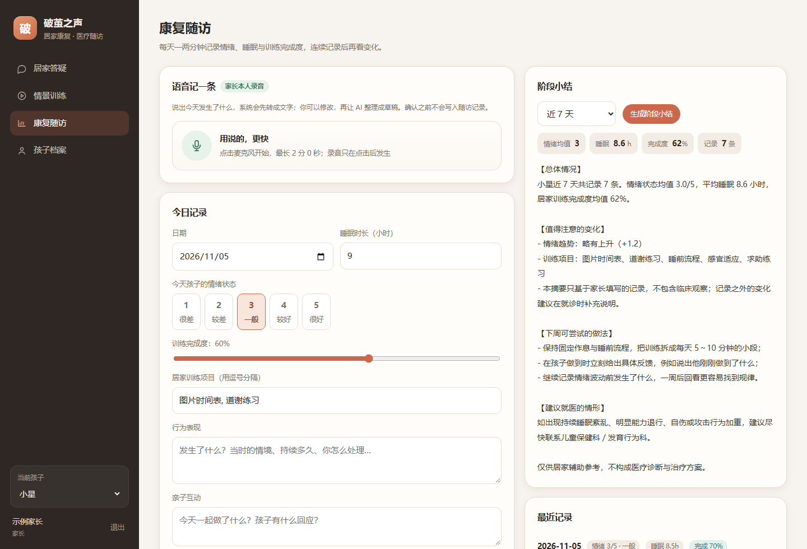

**未启用 ASR 时不会伪造结果**：默认 `ASR_PROVIDER=disabled`，上传接口返回 503 并说明如何配置。

本机 / 服务器部署 FunASR：

```bash
# 建议 Python 3.10-3.12；先装 torch 与 torchaudio
pip install torch torchaudio
pip install -r requirements-asr.txt
```

`.env`：

```env
ASR_PROVIDER=funasr
ASR_MODEL=paraformer-zh
ASR_VAD_MODEL=fsmn-vad
ASR_PUNC_MODEL=ct-punc
ASR_DEVICE=cpu
ASR_LANGUAGE=zh
```

首次识别会下载模型权重（需要网络与磁盘空间），之后复用缓存。也可以接云端，例如硅基流动
（OpenAI 兼容、国内直连、中文效果好）：

```env
ASR_PROVIDER=http
ASR_HTTP_URL=https://api.siliconflow.cn/v1/audio/transcriptions
ASR_HTTP_API_KEY=sk-你的硅基流动Key
ASR_HTTP_MODEL=FunAudioLLM/SenseVoiceSmall
ASR_HTTP_TRUST_ENV=false
```

`ASR_HTTP_TRUST_ENV=false` 表示调用云端时不读取系统代理；如果本机代理变量格式不标准
（例如 `NO_PROXY` 含 `[::1]`），开着它会导致 `InvalidURL`。

音频安全约束：

- 只接受 WebM / OGG / MP4 / WAV / MP3 / FLAC，且校验文件头而不是扩展名；
- 默认单文件 ≤ 20 MB、时长 ≤ 120 秒，超出直接拒绝；
- 音频写入临时目录，识别结束（含异常）立即删除，不对外提供静态访问；
- 浏览器 MediaRecorder 的 WebM 常常没有 duration 元数据（`Duration: N/A`），
  后端会再解码一遍取真实时长，避免把正常录音误判成“无法解析”；
- 日志只记录大小、时长、字符数，不记录转写正文；
- 草稿接口不写数据库，只有家长点「确认并保存」才落库。

> 当前开发环境已通过**硅基流动 SenseVoiceSmall** 接通云端 ASR，密钥只放在 `.env`；
> 本机没有安装 `torchaudio/funasr`，所以本地 FunASR 路径未验证，但仍保留为可切换 Provider。
> 真实测试：上传 5.5 秒中文 WAV / WebM，返回「欢迎大家来体验达摩院推出的语音识别模型。」

### 6.6 AI 回答朗读（TTS）

答疑页每条 AI 回答旁有喇叭按钮，右上角有「自动朗读 开/关」和音色选择；训练页教练提示也会朗读。
优先调用后端 **CosyVoice2（硅基流动）**，失败时自动回退浏览器系统语音。

```env
TTS_PROVIDER=siliconflow
TTS_MODEL=FunAudioLLM/CosyVoice2-0.5B
TTS_VOICE=FunAudioLLM/CosyVoice2-0.5B:diana
TTS_API_KEY=sk-你的硅基流动Key   # 留空时复用 ASR_HTTP_API_KEY
TTS_TRUST_ENV=false
```

可用音色：`diana`（默认）、`claire`、`alex`，前端右上角可切换。
音色选择默认是「跟随服务端」，即使用 `.env` 的 `TTS_VOICE`；只有手动选过音色才会覆盖。
接口是 `POST /api/v1/audio/speech`，返回 `audio/mpeg` 字节流，不落盘、不暴露 Key；
`GET /api/v1/audio/tts/health` 可查看 Provider、可用音色与服务端默认音色。

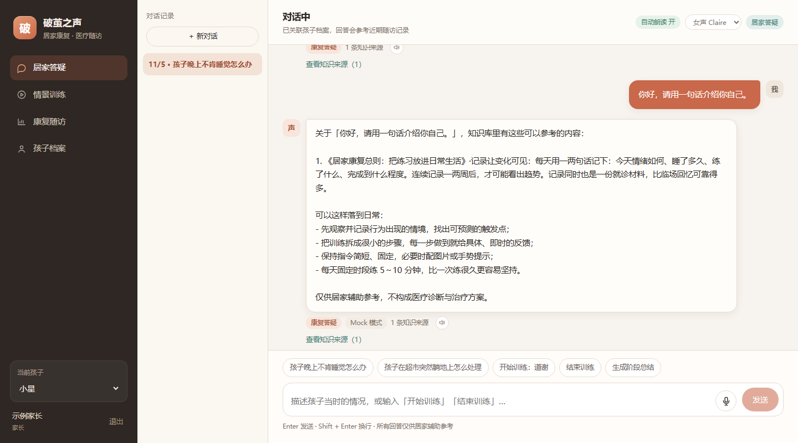

> 未配置 `TTS_PROVIDER` 时不会报错，前端会自动使用浏览器 `speechSynthesis`
> （Windows 上通常是 Microsoft Huihui），音色取决于系统语音包，效果不如 CosyVoice2。

### 6.7 临时公网访问（ngrok）

```powershell
# 1) 本机先启动服务（示例用 8012 端口）
$env:PORT=8012; python run.py

# 2) 另开终端，启动 ngrok（脚本会清掉代理环境变量，避免 ERR_NGROK_9009）
scripts\start_ngrok.cmd 8012
```

终端会打印 `https://xxxx.ngrok-free.dev`。免费版每次重启地址都会变，首次用浏览器打开会出现
ngrok 提示页，点 “Visit Site” 即可；前端已在 Axios 里带上 `ngrok-skip-browser-warning` 头，
接口不会被提示页拦截。

> 公网可访问意味着拿到链接的人都能注册和登录。演示时不要录入真实儿童信息；
> 正式对外前请设置强 `SECRET_KEY`、关闭公开注册，并加访问口令或 IP 白名单。

---

## 7. API 一览

统一前缀 `/api/v1`，除注册/登录外都需要 `Authorization: Bearer <token>`。

| 方法 | 路径 | 说明 |
| --- | --- | --- |
| POST | `/auth/register` | 注册（返回 JWT） |
| POST | `/auth/login` | 登录 |
| GET | `/auth/me` | 当前用户 |
| GET/POST | `/children` | 孩子档案列表 / 创建 |
| POST | `/chat` | **核心入口**：答疑、训练、随访记录、阶段总结 |
| GET | `/chat/sessions` | 会话列表 |
| GET | `/chat/sessions/{id}` | 会话详情（含消息与引用） |
| DELETE | `/chat/sessions/{id}` | 删除会话 |
| GET | `/training/scenarios` | 六类场景目录 |
| POST | `/training/start` | 独立训练页开始训练 |
| POST | `/training/{id}/answer` | 提交孩子回应，返回反馈与下一问 |
| POST | `/training/{id}/end` | 结束并生成训练小结 |
| POST | `/training/{id}/abort` | 放弃训练（不生成小结，也不会出现在「继续上次」） |
| GET | `/training/sessions` | 训练历史 |
| GET | `/game/scenarios` | 六个 2D 关卡的房间/角色摘要 |
| GET | `/game/{id}` | 世界配置 + 当前训练回合 + 存档（房间/坐标/已观察） |
| PUT | `/game/{id}/state` | 保存空间进度（坐标越界会被夹回房间内） |
| POST | `/game/{id}/turn` | 游戏内作答：走 LangGraph → 训练状态机 → 返回表扬/提示 |
| POST | `/followup/records` | 创建每日记录 |
| POST | `/followup/voice-draft` | 家长确认文本 → 结构化随访草稿（不落库） |
| POST | `/audio/transcribe` | 上传音频并转写（multipart，JWT） |
| POST | `/audio/speech` | 文本转语音（CosyVoice2，返回 audio/mpeg） |
| GET | `/audio/tts/health` | TTS Provider、可用音色与字数限制 |
| GET | `/audio/health` | ASR Provider 与限制参数 |
| GET | `/followup/records?child_id=` | 记录列表 |
| POST | `/followup/summary` | 生成阶段小结（含指标） |
| GET | `/followup/summaries?child_id=` | 历史小结 |
| GET | `/knowledge/docs` | 知识文档与块数 |
| POST | `/knowledge/search` | 检索调试（返回向量/词法/融合分数） |
| POST | `/knowledge/ingest` | 重新入库（professional / admin） |
| GET | `/safety/events` | 安全事件审计（admin） |
| GET | `/health` | 健康检查（组件与知识块数量） |

`POST /chat` 响应示例（截断）：

```json
{
  "session_id": "1d4f...",
  "reply": "关于「孩子晚上不肯睡觉…」，知识库里有这些可以参考的内容：…",
  "intent": "qa",
  "mode": "qa",
  "safety": {"level": "normal", "categories": []},
  "citations": [
    {"index": 1, "title": "睡眠与作息：把睡前变成可预测的流程", "section": "固定流程比固定时间更关键", "score": 0.41}
  ],
  "meta": {"llm_provider": "mock", "mocked": true, "retrieved": 3}
}
```

---

## 8. 数据模型

| 表 | 作用 |
| --- | --- |
| `users` | 账号、角色（parent / professional / admin） |
| `children` | 孩子档案（家长自述，不含诊断结论） |
| `chat_sessions` / `chat_messages` | 会话与消息（含 intent、安全等级、引用 JSON） |
| `training_sessions` | 训练状态：场景、步骤、提示层级、transcript、小结 |
| `training_world_states` | 2D 游戏存档：房间、角色坐标、已观察热点、操作流水 |
| `followup_records` | 每日情绪 / 睡眠 / 行为 / 训练完成度 |
| `followup_summaries` | 阶段小结正文与聚合指标 |
| `safety_events` | 安全拦截审计 |
| `knowledge_docs` | 知识文档 checksum 与块数 |

生产环境建议用 Alembic 管理迁移（当前为 `create_all`，便于演示）。

---

## 9. 测试与验证

```bash
python -m pytest -q            # 66 passed
python -m scripts.smoke_e2e    # 对运行中的服务跑完整链路
```

测试覆盖：

- `test_security.py`：scrypt 哈希、JWT 签发/篡改/过期；
- `test_safety.py`：急症、诊断、用药、未验证疗法、输出越界清洗、免责声明幂等；
- `test_rag.py`：文档解析、切分、入库、混合检索、阈值、引用编号去重；
- `test_training.py`：推进、三级提示、提示耗尽后跳过、AAC 回应、幂等结束、放弃训练、越权 404；
- `test_game.py`：六个世界与训练脚本逐字对齐、跨房间顺序、角色锚点、存档往返、越界夹取、游戏回合复用训练流程、安全兜底、越权 404；
- `test_chat_api.py`：答疑引用、急症拦截、聊天内模式切换、会话增删、401；
- `test_audio.py`：音频头校验、大小/时长限制、ASR 成功/超时/未启用、草稿结构、越权与未登录；
- `test_followup.py`：记录校验、指标均值、阶段小结、跨用户隔离。

冒烟脚本会依次验证：登录 → 健康检查 → RAG 答疑（带引用）→ 安全拦截 → 聊天内训练 → 训练小结 → 随访记录与阶段小结 → 知识检索。

---

## 10. 配置说明

常用环境变量（完整见 `.env.example`）：

| 变量 | 默认 | 说明 |
| --- | --- | --- |
| `LLM_PROVIDER` | `mock` | `mock` / `deepseek` |
| `DEEPSEEK_API_KEY` | 空 | 为空时自动降级 Mock |
| `EMBEDDING_PROVIDER` | `hash` | `hash` / `bge-m3` / `http` |
| `VECTOR_BACKEND` | `memory` | `memory` / `milvus` |
| `DATABASE_URL` | SQLite | `mysql+aiomysql://...` |
| `CACHE_ENABLED` | `true` | Redis 不可用时自动使用进程内缓存 |
| `RAG_TOP_K` / `RAG_MIN_SCORE` | 4 / 0.3 | 召回条数与融合分数阈值 |
| `RAG_CHUNK_SIZE` / `OVERLAP` | 320 / 60 | 切块参数 |
| `HISTORY_WINDOW` | 10 | 送入模型的历史消息条数 |
| `TRAINING_MAX_HINT_LEVEL` | 2 | 分层提示层数（第 3 次给示范） |
| `GAME_LLM_JUDGE` | `true` | 2D 游戏里的儿童回答是否允许 DeepSeek 语义复判（仅 `LLM_PROVIDER=deepseek` 生效） |

---

## 11. 已知边界与生产化 TODO

**明确的边界**

- `knowledge/` 是**示例知识库**，内容依据公开家长手册与临床实践共识整理，上线前必须由儿童保健科 / 发育行为科专业人员逐条审核；
- 系统不做诊断、不做康复评定、不给用药建议，不能替代医生与持证康复师；
- 默认的 hash 向量只保证链路可跑通，不具备语义泛化能力，生产请切 BGE-M3 或远程嵌入；
- Mock 模式只是模板生成，响应里会标记 `mocked: true`，不要用于真实业务；
- **ASR 默认 `disabled`**，未配置时上传接口返回 503 而不是伪造识别结果；
  当前开发环境已通过硅基流动 SenseVoiceSmall 接通（Key 在 `.env`），本地 FunASR 权重未安装。
  测试中的 Fake Provider 仅用于验证接口契约；
- **TTS 优先使用云端 CosyVoice2**，失败才回退浏览器系统语音；音色与效果取决于所选 Provider 与语音包。

**下一步可以做的**

1. Alembic 迁移 + 生产级连接池参数；
2. RAG 评估集（100 条家长真实问题 + 标准片段），持续跟踪 Recall@K 与无答案拒答率；
3. 知识库审核工作流（草稿 / 审核 / 发布三态 + 审核人字段）；
4. 安全分类器与规则并行（LLM 判别隐晦的自伤风险表述）；
5. ASR 真机部署：下载 FunASR 权重、验证中文识别效果，再考虑流式识别与 GPU；
6. 可观测性：OpenTelemetry + 每次生成的 trace（检索片段、Prompt 版本、token 消耗）；
7. 前端：会话搜索、随访趋势图、无障碍与移动端适配。

---

<p align="center">
  <sub>破茧之声 · 居家康复辅助工具 · 不构成医疗诊断与治疗方案</sub>
</p>
