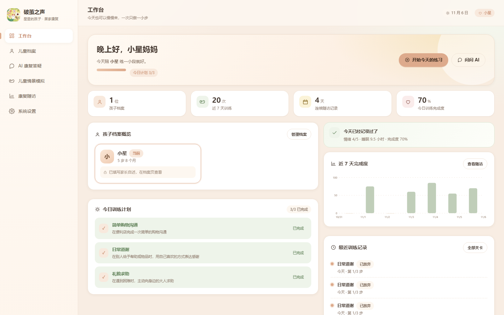
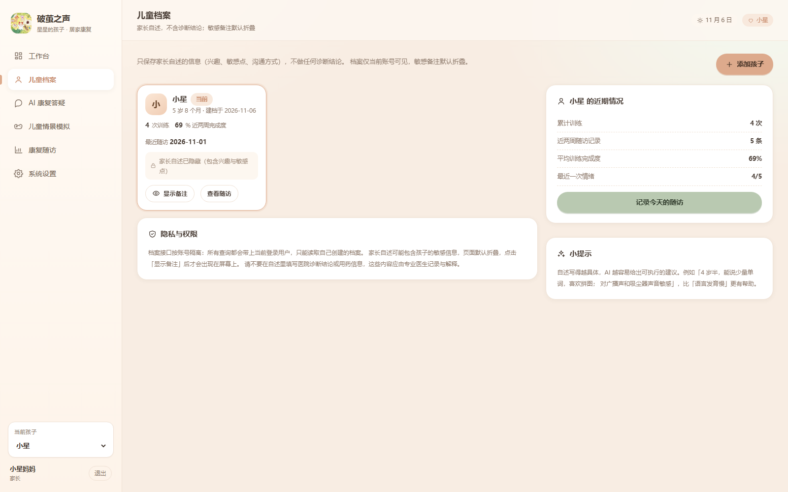
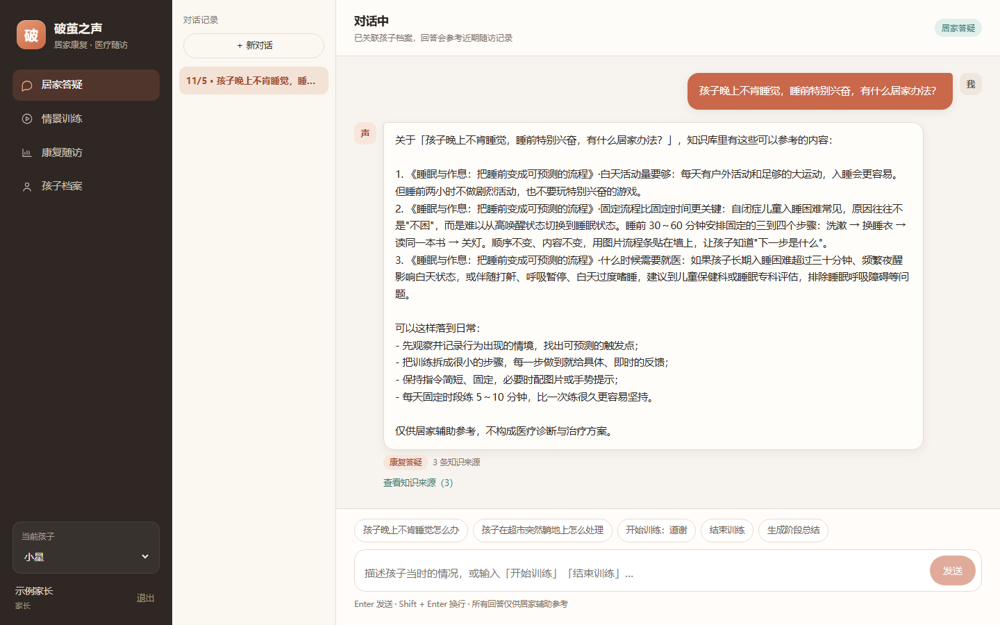
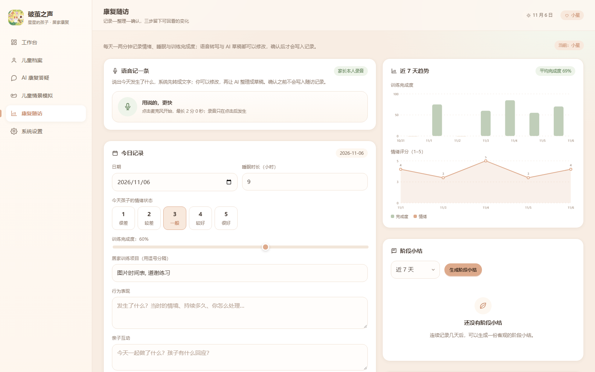
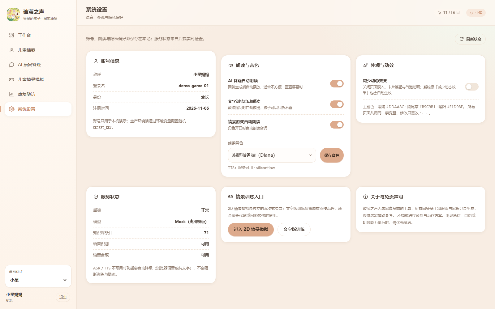
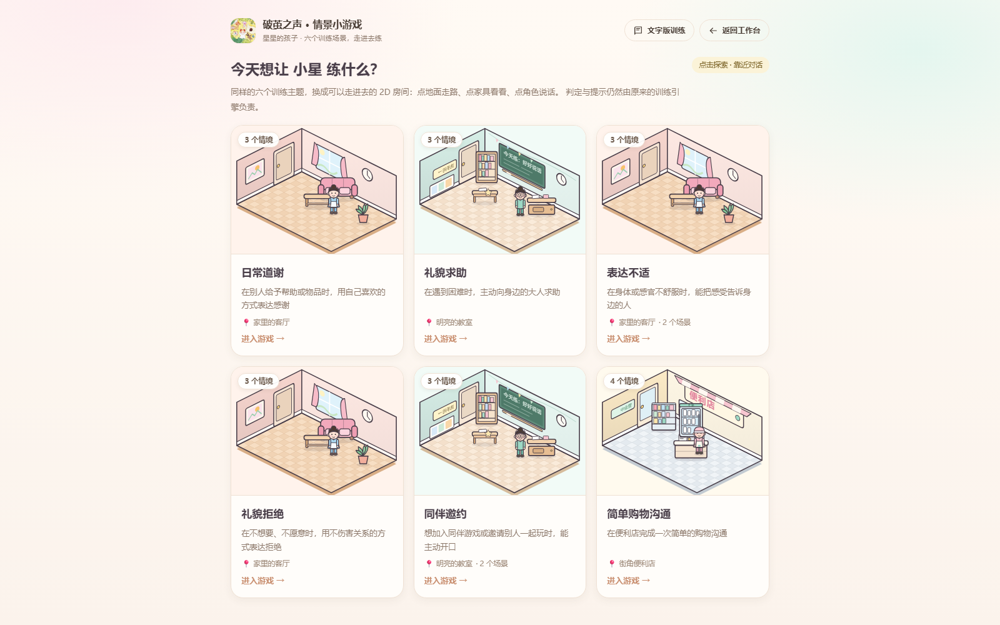
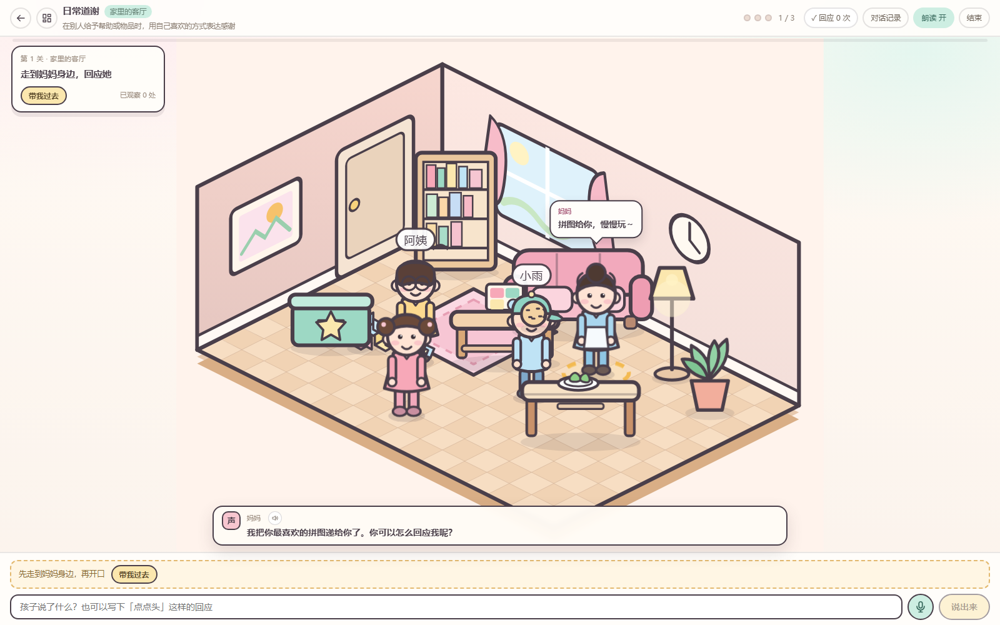

# 星星的孩子 · 前端设计系统

> 用心温暖每一颗独一无二的星星。


> 本文件记录「破茧之声」前端视觉升级的设计规范与落地方式。
> 所有规范都已经在 `web/src/styles.css` 中实现，页面不再硬编码颜色。

## 一、两套界面，一个品牌

| | 管理后台 | 儿童情景模拟 |
| --- | --- | --- |
| 使用场景 | 家长 / 康复从业者日常管理 | 孩子坐下来练一个情境 |
| 布局 | 左侧导航 + 顶部工具栏 + 卡片内容 | 沉浸式全屏，无后台侧边栏 |
| 气质 | 轻量 SaaS、留白、信息层级清晰 | 明亮、可爱、马卡龙、可点击探索 |
| 配色 | 暖陶 / 鼠尾草 / 暖阳 + 奶油白 | 沿用品牌色，但场景本身使用更活泼的马卡龙色 |
| 字体 | 同一套系统中文字体栈 | 同左 |
| 圆角 | 14–26px | 卡片 20px，场景内 16–24px |

两套界面共用导航品牌、色板、按钮语义与「不刺眼、不高饱和」的底线；
游戏内部的美术规范（2D 等距、粗描边、手绘）不受后台风格影响。

## 二、主题变量

```css
:root {
  --color-page: #f8ede3;
  --color-surface: #ffffff;
  --color-primary: #ddaa8c;
  --color-primary-hover: #c98f70;
  --color-secondary: #b9c9b1;
  --color-accent: #f1d98f;
  --color-pink: #e7c5c0;
  --color-text: #493d35;
  --color-text-secondary: #8c786a;
  --color-border: #efe1d4;
}
```

派生变量：`--color-primary-soft`、`--color-secondary-soft`、`--color-accent-soft`、
`--color-danger`、`--color-muted`、`--shadow-sm/md/lg`、`--radius-*`。

对比度处理：主按钮使用暖陶底 + 深棕文字（`#3B2A1F`），避免白字在浅陶色上对比不足；
正文使用 `#493D35`，在白底与奶油底上都保持可读。

## 三、页面与路由

| 路由 | 页面 | 说明 |
| --- | --- | --- |
| `/dashboard` | 工作台 | 欢迎信息、孩子概览、今日计划、最近训练、随访提醒、AI 快捷入口 |
| `/children` | 儿童档案 | 档案卡片、训练/随访概览、敏感备注默认折叠 |
| `/chat` | AI 康复答疑 | 会话列表、气泡、引用来源、语音输入、自动朗读 |
| `/game` | 儿童情景模拟 | 沉浸式独立页面（`meta.immersive`），六个原有场景 |
| `/followup` | 康复随访 | 语音转写 → AI 草稿 → 家长确认；趋势图与阶段小结 |
| `/settings` | 系统设置 | 账号、朗读、动效、服务状态、训练入口、免责声明 |
| `/training` | 文字版训练 | 保留原有轻量流程，从工作台 / 游戏入口进入 |

根路径 `/` 重定向到工作台；登录成功后进入工作台。

## 四、组件规范

| 组件 | 类名 | 变体 |
| --- | --- | --- |
| 按钮 | `.btn` | `secondary` / `ghost` / `soft` / `danger` / `small` / `block` / `icon` |
| 输入 | `.input` `.textarea` `.select` | 统一 14px 圆角、暖陶聚焦环 |
| 卡片 | `.card` | `lift`（悬停浮起）、`card-head`、`card-title`、`card-sub` |
| 标签 | `.badge` | `primary` / `secondary` / `accent` / `pink` / `danger` / `toggle` |
| 弹窗 | `.modal-mask` `.modal-card` | 遮罩模糊、进入动画 |
| 状态 | `.state-block` | `loading`（骨架）/ `empty` / `error`；封装为 `StateBlock.vue` |
| 开关 | `.switch` | 设置页使用，支持键盘聚焦 |
| 图表 | `.chart-svg` | `TrendChart.vue`，折线 / 柱状，低饱和暖色 |
| 导航 | `.sidebar` `.nav-item` | 激活态白底 + 左侧色条；≤720px 收成图标条 |
| 气泡 | `.bubble` | 用户气泡暖陶底，AI 气泡白底带细描边 |

图标统一使用 `AppIcon.vue`（24×24 线性图标，无第三方图标库依赖），
避免同一语义在不同页面出现不同图形。

## 五、动效与无障碍

- 页面进入：`page-in` 淡入 + 6px 上移，0.32s；
- 卡片悬停：上移 2px + 阴影加深；
- 按钮悬停：上移 1px + 阴影；
- 气泡出现：`bubble-in` 0.26s；
- 进度条：宽度 0.5s 平滑过渡；
- 尊重 `prefers-reduced-motion`，并在设置页提供「减少动态效果」开关（写入 `localStorage`）；
- 所有交互控件保留 `:focus-visible` 轮廓；
- 折叠的敏感备注必须点击「显示备注」才会渲染到页面。

## 六、响应式

| 断点 | 行为 |
| --- | --- |
| ≤1180px | 工作台 / 随访双列改为单列 |
| ≤1024px | 档案页双列改为单列 |
| ≤960px | 侧边栏改为顶部图标条；答疑会话栏收起 |
| ≤720px | 品牌文字收起、仅保留图标；统计卡两列；表单单列；登录页隐藏插画 |
| 游戏页 | ≤860px 顶栏换行、任务卡缩小；≤720px 教练条与作答栏压缩 |

## 七、截图








