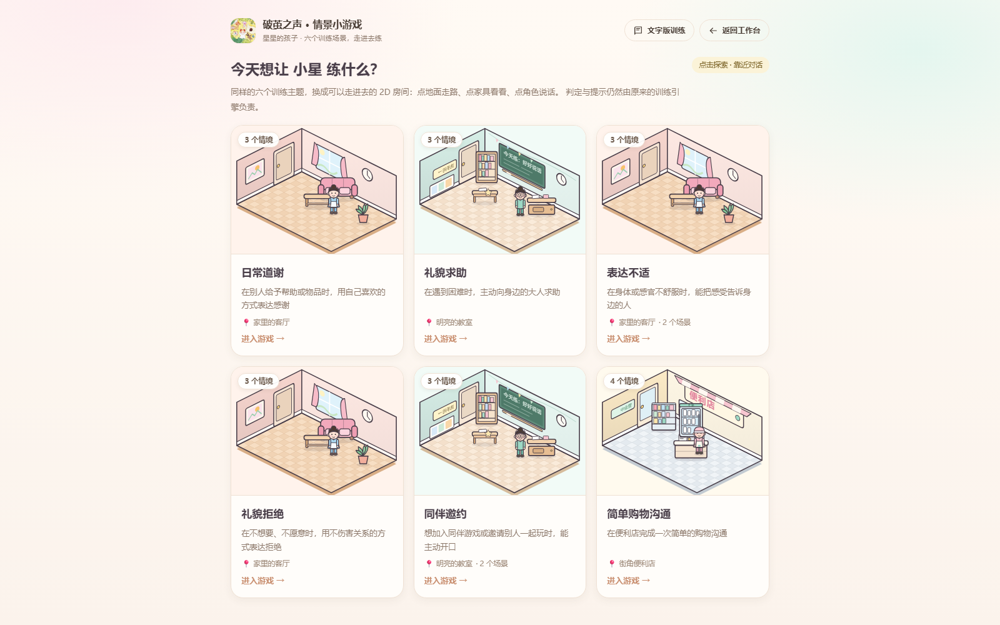
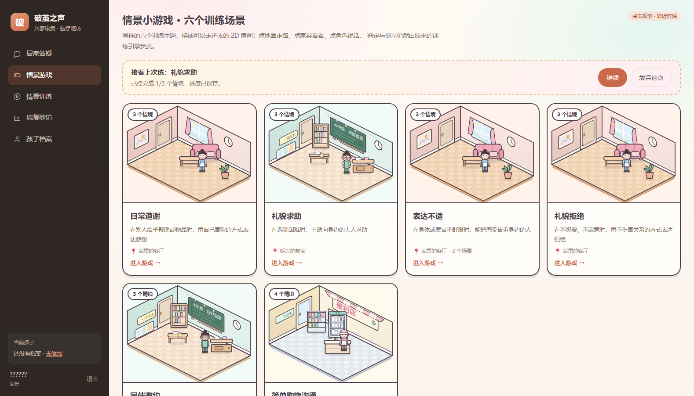
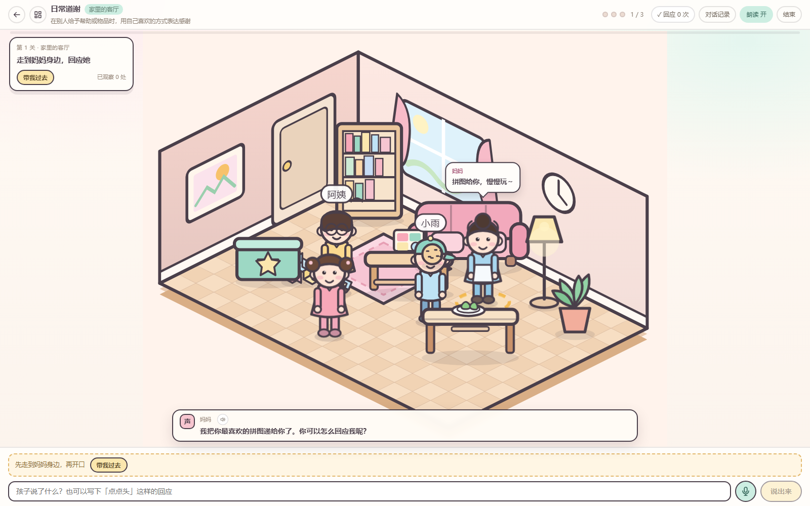
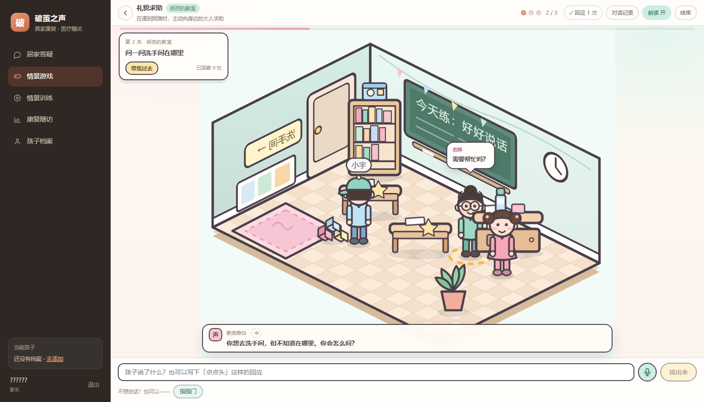
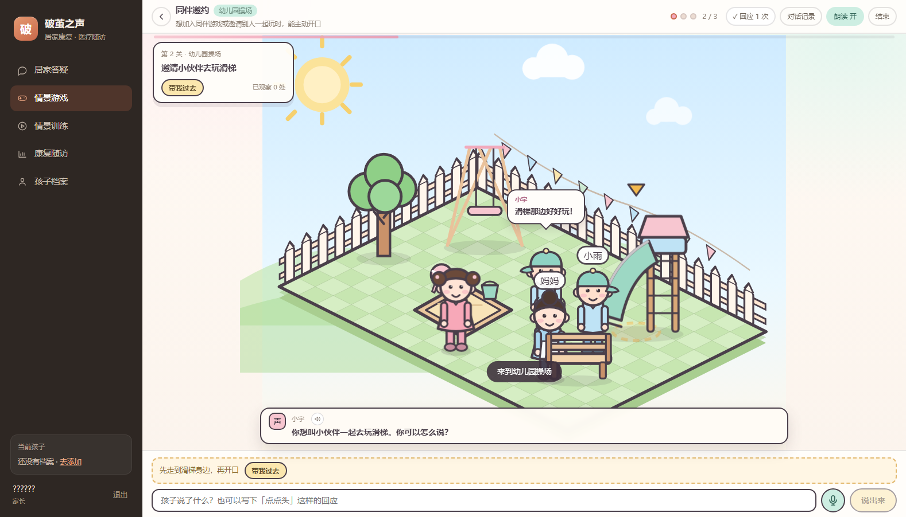
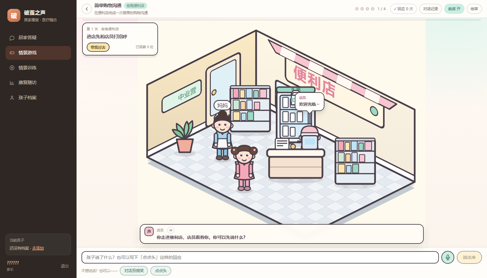
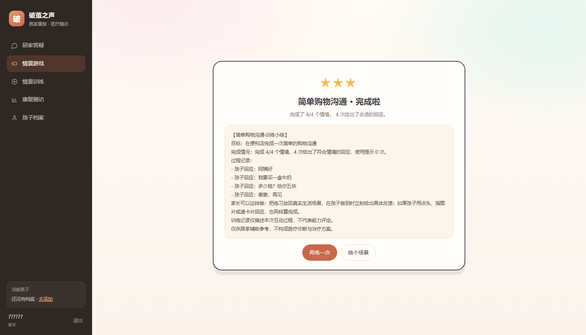

# 六场景 2D 等距点击探索游戏 · 设计文档

> 本文档对应「把项目已有六个训练场景升级为 2D 等距点击探索式儿童游戏」的第一步：**代码盘点 + 场景映射表**。
> 所有内容以仓库现有代码为准，不新增、不删除、不替换任何训练主题。

## 一、代码盘点结论

盘点范围：`app/services/training_scripts.py`、`app/services/training.py`、`app/agents/{graph,nodes,state}.py`、`app/api/v1/training.py`、`web/src/views/TrainingView.vue`、`app/db/models.py`。

| 事实 | 位置 | 对游戏化的约束 |
| --- | --- | --- |
| 训练主题只有 6 个，键为 `thanks / help / discomfort / refuse / invite / shopping` | `app/services/training_scripts.py:34` | 游戏必须原样沿用这 6 个 key 与中文名 |
| 每个主题由 3～4 个 `ScenarioStep` 组成（`shopping` 为 4 步） | 同上 | 游戏任务数 = 步骤数，不可自行增删 |
| 每步有 `prompt / expected / hints(3 级) / praise / example` | 同上 | 提示语与表扬语必须来自后端，不允许前端另写一套 |
| 状态机 `TrainingService.respond()` 负责评价、分层提示、推进、小结 | `app/services/training.py:170` | 游戏只负责「把情境演出来」，判定必须回流该服务 |
| 只有 `active` 训练会被 `analyze` 判定为 `training_turn` | `app/agents/nodes.py:66` | 聊天内训练与独立训练页已有两条入口 |
| `POST /training/start|{id}/answer|{id}/end` 是既有业务接口 | `app/api/v1/training.py` | 游戏复用这三个接口，不另建训练内核 |
| ASR `POST /audio/transcribe`、TTS `POST /audio/speech` 已可用 | `app/api/v1/audio.py`、`web/src/utils/speech.js` | 游戏内语音输入/朗读直接复用 |
| 前端训练页目前是「文字对话框 + 文本框」 | `web/src/views/TrainingView.vue` | 需要替换为可点击探索的 2D 舞台，但保留原页面作为无障碍降级入口 |
| 测试断言 6 个场景 key 与 3 步流程 | `tests/test_training.py:8` | 任何改动必须保持这些断言通过 |

## 二、场景映射表（真实配置 → 游戏世界）

下表左半部分来自代码，右半部分是本游戏新增的「演出层」（只描述空间/角色/热点，不改训练内容）。

### 1. `thanks` · 日常道谢（对应主题：表达感谢）

| 项 | 内容 |
| --- | --- |
| 训练目标 | 在别人给予帮助或物品时，用自己喜欢的方式表达感谢 |
| 空间环境 | 家庭客厅 `home_living`（沙发、茶几、餐桌、积木箱、地毯） |
| 固定角色 | 小朋友（玩家）· 妈妈（家长）· 阿姨 · 小伙伴 |
| 热点 | `sofa` 沙发、`puzzle` 拼图（茶几上）、`crayons` 蜡笔（地毯）、`biscuit` 饼干、`toy_box` 积木箱、`plant` 绿萝、`bookshelf` 书架 |

| 步骤 | 训练 prompt（原文） | 说话人 | 焦点热点 | HUD 任务 |
| --- | --- | --- | --- | --- |
| 1 | 我把你最喜欢的拼图递给你了。你可以怎么回应我呢？ | 妈妈 | `puzzle` | 走到妈妈身边，回应她 |
| 2 | 刚才阿姨帮你把掉在地上的蜡笔捡起来了。你会对阿姨说什么？ | 阿姨 | `crayons` | 谢谢阿姨帮你捡蜡笔 |
| 3 | 小朋友把一块饼干分给你，你还想要一点点。你可以怎么说？ | 小伙伴 | `biscuit` | 谢谢小伙伴，并说出还想要 |

非语言表达按钮：点点头 / 对妈妈微笑 / 指指拼图 · 指指阿姨 · 指指饼干。

### 2. `help` · 礼貌求助（对应主题：礼貌求助）

| 项 | 内容 |
| --- | --- |
| 训练目标 | 在遇到困难时，主动向身边的大人求助 |
| 空间环境 | 教室 `classroom`（黑板、讲台、书架、课桌、阅读角） |
| 固定角色 | 小朋友（玩家）· 老师 · 小伙伴 |
| 热点 | `puzzle_box` 拼图盒（书架顶层）、`teacher_desk` 讲台、`water_bottle` 水杯、`desk` 课桌、`bookshelf` 书架、`plant` 绿植 |

| 步骤 | 训练 prompt（原文） | 说话人 | 焦点热点 | HUD 任务 |
| --- | --- | --- | --- | --- |
| 1 | 拼图盒子放在架子最上面，你够不到。你可以怎么对我说？ | 老师 | `puzzle_box` | 请老师帮你拿拼图 |
| 2 | 你想去洗手间，但不知道在哪里。你会怎么问？ | 老师 | 老师 | 问一问洗手间在哪里 |
| 3 | 水杯盖太紧了，你打不开。旁边有老师在。你可以怎么说？ | 老师 | `water_bottle` | 请老师帮你打开水杯 |

非语言表达按钮：指指架子 / 指指门 / 递水杯给老师。

### 3. `discomfort` · 表达不适（对应主题：表达不适）

| 项 | 内容 |
| --- | --- |
| 训练目标 | 在身体或感官不舒服时，能把感受告诉身边的人 |
| 空间环境 | 客厅 `home_living` → 教室 `classroom` → 客厅 `home_living`（同一场景内换房间） |
| 固定角色 | 小朋友（玩家）· 妈妈（家长）· 老师 |
| 热点 | `sofa` 沙发、`dining_table` 餐桌、`desk` 课桌、`teacher_desk` 讲台、`plant` 绿萝 |

| 步骤 | 训练 prompt（原文） | 说话人 | 焦点热点 | HUD 任务 |
| --- | --- | --- | --- | --- |
| 1 | 你的肚子有点疼。你可以怎么告诉我？ | 妈妈（客厅） | 妈妈 | 告诉妈妈你肚子疼 |
| 2 | 教室里的声音太大了，你觉得吵得难受。你会怎么说？ | 老师（教室） | 老师 | 告诉老师声音太吵了 |
| 3 | 你玩了一上午，觉得有点累了。你可以怎么跟我说？ | 妈妈（客厅） | `sofa` | 告诉妈妈你累了 |

非语言表达按钮：指指肚子 / 指指耳朵 / 指指沙发。

### 4. `refuse` · 礼貌拒绝（对应主题：礼貌拒绝）

| 项 | 内容 |
| --- | --- |
| 训练目标 | 在不想要、不愿意时，用不伤害关系的方式表达拒绝 |
| 空间环境 | 客厅 `home_living`（餐桌、沙发区、积木区） |
| 固定角色 | 小朋友（玩家）· 妈妈（家长）· 阿姨 · 小伙伴 |
| 热点 | `plate` 餐盘里的青椒、`dining_table` 餐桌、`toy_box` 积木箱、`blocks` 积木 |

| 步骤 | 训练 prompt（原文） | 说话人 | 焦点热点 | HUD 任务 |
| --- | --- | --- | --- | --- |
| 1 | 我把青椒放到你的碗里了，你不想吃。你可以怎么跟我说？ | 妈妈 | `plate` | 告诉妈妈你不想吃青椒 |
| 2 | 有人想抱你，你现在不想被抱。你可以怎么说？ | 阿姨 | 阿姨 | 告诉阿姨你现在不想被抱 |
| 3 | 你还想再玩一会儿积木，但你现在想去做别的事。你会怎么跟小伙伴说？ | 小伙伴 | `blocks` | 告诉小伙伴你想先停下 |

非语言表达按钮：摇摇头 / 指指积木。

### 5. `invite` · 同伴邀约（对应主题：主动打招呼 / 主动发起社交）

| 项 | 内容 |
| --- | --- |
| 训练目标 | 想加入同伴游戏或邀请别人一起玩时，能主动开口 |
| 空间环境 | 教室 `classroom` → 操场 `playground` → 操场 `playground` |
| 固定角色 | 小朋友（玩家）· 小伙伴（两人）· 妈妈（操场长椅旁）· 老师（教室） |
| 热点 | `blocks` 积木、`slide` 滑梯、`swing` 秋千、`sandbox` 沙池、`bench` 长椅 |

| 步骤 | 训练 prompt（原文） | 说话人 | 焦点热点 | HUD 任务 |
| --- | --- | --- | --- | --- |
| 1 | 几个小朋友在搭积木，你也想一起搭。你可以怎么问？ | 小伙伴 | `blocks` | 问问小伙伴能不能一起玩 |
| 2 | 你想叫小伙伴一起去玩滑梯。你可以怎么说？ | 小伙伴 | `slide` | 邀请小伙伴去玩滑梯 |
| 3 | 小伙伴说「我现在不想玩」。你可以怎么回应，让自己也好受一点？ | 小伙伴 | 小伙伴 | 小伙伴拒绝了，试试回应他 |

非语言表达按钮：指指积木 / 指指滑梯 / 点点头。

> 关于主题「主动打招呼」：现有配置中没有独立的「打招呼」场景，打招呼行为真实分布在两处 —— `shopping` 第 1 步「进店打招呼」和 `invite` 的「主动开口发起互动」。按「不新增、不删除、不替换」的约束，本游戏保留 `invite` 作为主动社交场景，并在 `shopping` 第一关以「走到店门口先打招呼」完整复现打招呼训练，未另建第 7 个场景。

### 6. `shopping` · 简单购物沟通（对应主题：简单购物）

| 项 | 内容 |
| --- | --- |
| 训练目标 | 在便利店完成一次简单的购物沟通 |
| 空间环境 | 便利店 `store`（货架、冷藏柜、收银台、购物篮、门口） |
| 固定角色 | 小朋友（玩家）· 店员 · 妈妈（家长，在门口等候） |
| 热点 | `fridge` 冷藏柜、`milk` 牛奶、`counter` 收银台、`shelf` 货架、`basket` 购物篮 |

| 步骤 | 训练 prompt（原文） | 说话人 | 焦点热点 | HUD 任务 |
| --- | --- | --- | --- | --- |
| 1 | 你走进便利店，店员看着你。你可以先说什么？ | 店员 | 店员 | 进店先和店员打招呼 |
| 2 | 你想买一盒牛奶。你可以怎么跟店员说？ | 店员 | `milk` | 告诉店员你要买牛奶 |
| 3 | 店员把牛奶递给你，说「五块钱」。你可以怎么问或怎么说？ | 店员 | `counter` | 问价格并付款 |
| 4 | 你拿到牛奶，准备离开了。你可以对店员说什么？ | 店员 | 店员 | 谢谢店员，说再见 |

非语言表达按钮：对店员微笑 / 点点头 / 指指牛奶 / 递钱给店员（打招呼关用「微笑 + 点头」，与既有 `AAC_CUES` 保持一致）。

## 三、统一游戏引擎设计

六个场景共用同一套引擎，只有配置不同。

```text
web/src/game/
├── iso.js                 # 等距投影 / 反投影 / 深度排序键
├── pathfinding.js         # 网格 A* + 直线可达裁剪（点击寻路）
├── useGameEngine.js       # 角色状态、rAF 主循环、寻路、互动、对话、任务同步
├── art/
│   ├── RoomShell.vue      # 四种空间的墙/地板/窗外景（home/classroom/playground/store）
│   ├── PropSprite.vue     # 27 个道具的手绘 SVG 造型
│   └── CharacterSprite.vue# 小朋友/老师/家长/阿姨/小伙伴/店员
├── GameStage.vue          # SVG 舞台：地板 → 墙 → 实体（按深度排序）→ 热区 → 气泡
├── GameThumb.vue          # 选关缩略图（复用同一套房间资产）
├── GameComposer.vue       # 文字 / 语音(ASR) / 非语言表达按钮
└── game.css               # 马卡龙配色、气泡、任务卡、完成页
```

页面层在 `web/src/views/GameView.vue`：选关 → 进入世界 → 回合推进 → 完成页，
顶部任务卡、步骤圆点、朗读开关、对话记录与底部「教练条 + 作答面板」都在这里编排。

数据契约（后端 → 前端）：`GET /api/v1/game/scenarios` 返回六个世界摘要；`GET /api/v1/game/{training_id}` 返回

```json
{
  "world": {"scenario":"thanks","start_scene":"home_living",
            "scenes":{"home_living":{"env":"indoor","art":"home","props":[...],"npcs":[...],"spawn":{...}}},
            "steps":[{"index":0,"scene":"home_living","speaker":"mom","focus":"puzzle",
                      "task":"...","voice":"npc","gestures":["点点头"],"line":"..."}]},
  "training": {"id":"...","step_index":0,"prompt":"我把你最喜欢的拼图递给你了……","status":"active"},
  "state": {"scene":"home_living","player":{"x":7.6,"y":9.2},"visited":[],"actions":[]}
}
```

前端只认 `art` 键来画图；后端只描述「哪里有什么、这一步谁说话、焦点是谁」。**判定与文案全部由后端返回**，前端不复制任何训练语料。

## 四、交互与复用链路

```text
点击地面  → iso 反投影 → A* 寻路 → rAF 逐帧移动（角色靠近）
点击家具  → 角色走到互动锚点 → 观察气泡（探索度 +1）
点击角色  → 角色走到 NPC 面前 → NPC 回应 / 打开作答面板
作答      → POST /api/v1/game/{id}/turn
              └→ LangGraph analyze（安全检查）→ training_turn
                   └→ TrainingService.respond()（评价 / 分层提示 / 推进 / 小结）
                        └→ DeepSeek 语义复判（仅在确定性规则未通过时，可降级为 None）
语音      → POST /api/v1/audio/transcribe（复用 ASR）
朗读      → POST /api/v1/audio/speech + 浏览器语音兜底（复用 speech.js）
存档      → training_world_states 表（房间 / 坐标 / 已观察热点 / 操作流水）
```

## 五、验收清单

- [x] 六个场景 key 与 `SCENARIOS` 完全一致，步骤数一致，prompt 文本逐字来自后端。
- [x] 每个场景都能：点地面走路、点家具观察、点 NPC 对话、靠近后作答、气泡显示、任务勾选、进度落库并刷新后恢复。
- [x] 跨房间场景可以真实换房间（表达不适：客厅 → 教室 → 客厅；同伴邀约：教室 → 操场）。
- [x] 游戏内输入同样经过医疗安全规则：急症表述会显示安全提示卡且不推进训练。
- [x] 分镜排版：教练条浮在场景底部，房间铺满可用高度；底部只留一行作答栏。
- [x] 「继续上次」显示场景名与已完成回合；只练了 0 步的会话会被直接关闭，不会反复提示。
- [x] `pytest` 66 passed、`ruff` 全绿、`pnpm build` 通过；原 `/training` 文字训练页保持可用。

## 六、实现记录（本次交付）

| 层 | 文件 | 说明 |
| --- | --- | --- |
| 世界配置 | `app/services/game_worlds.py` | 四个房间模板 + 六个关卡绑定；`validate_worlds()` 在测试里逐项校验 |
| 游戏接口 | `app/api/v1/game.py` | 关卡列表、世界+存档、存档写入、游戏回合 |
| 存档 | `app/services/training_world.py` + `training_world_states` 表 | 坐标夹取、列表去重、最多 120 条操作流水 |
| 继续上次 | `GET /training/sessions` + `POST /training/{id}/abort` | 只把「真的练过」的会话列为可继续；进场景没作答就退出会直接标记 aborted |
| 语义复判 | `app/services/training_judge.py` | 仅 `deepseek` 且 `GAME_LLM_JUDGE=true` 时可把「换种说法」判过 |
| 图入口 | `app/agents/nodes.py` | 带 `training_id` 的请求直接进 `training_turn`，安全审核照常先跑 |
| 引擎 | `web/src/game/*` | 投影、A*、rAF 主循环、深度排序、气泡、作答面板 |
| 页面 | `web/src/views/GameView.vue` | 独立沉浸式路由（无后台侧边栏）；选关 / 游戏 / 完成 / 继续上次 / 对话记录 |
| 入口 | 工作台「今日训练计划」 | 带 `?scenario=thanks` 直接进关，与后台品牌色衔接 |

浏览器实测（headless Chrome + CDP，1600×1000 窗口）：六个关卡各走完一遍，
覆盖点击寻路、点角色对话、非语言按钮、提示回退、跨房间切换、安全拦截、存档恢复与完成页。








